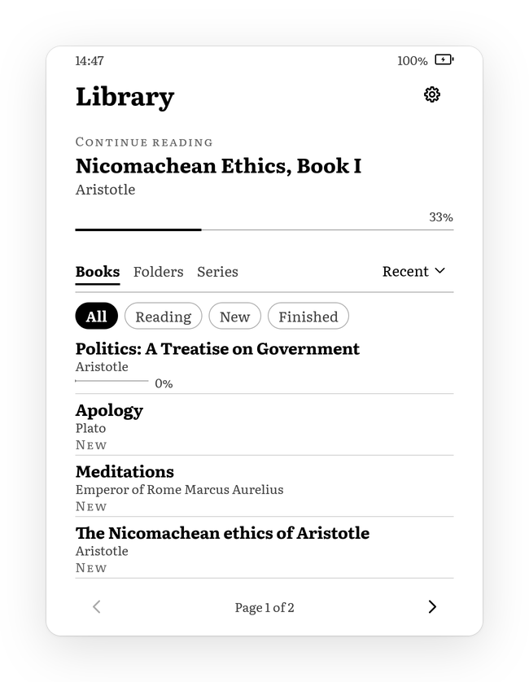

# Book library

`crates/aristotle-library` finds, identifies and describes the books on the device, keeps their reading state, and imports what earlier readers left behind. It is pure Rust with no C dependencies and builds statically for `armv7-unknown-linux-musleabihf`. `aristotle-library-cli` drives it from a shell on the host or over SSH on the Kindle.

Sources are marked as in the rest of the docs: **[fw]** read from firmware 5.13.6, **[host]** verified on the host with real files, **[dev]** verified on files copied from our device, **[KOReader]**, **[calibre]** borrowed from those projects, and **[inference]** for anything not yet confirmed.



## Layout

| Module | What |
| --- | --- |
| `library` | `Library`: open, incremental `scan`, queries, progress, clippings and sidecar import |
| `format` | Format detection by magic bytes |
| `metadata` | `Metadata` and the folder and file-name fallbacks |
| `epub`, `mobi`, `pdf` | Per-format parsers (`epub` also handles CBZ) |
| `zip` | Read-only ZIP over `miniz_oxide` |
| `cover` | Decode, downscale, dither to 16 grays, PGM cache |
| `index` | The persistent records: metadata, progress, settings, annotations |
| `query` | Sort, filter and search |
| `clippings`, `sidecar` | `My Clippings.txt`, stock KRDS sidecars, KOReader `metadata.*.lua` |
| `export` | Writing highlights: `My Clippings.txt` (stock template) and Markdown per book |
| `encoding`, `text`, `id` | Legacy encodings, diacritic folding, partial MD5 |

Dependencies: `serde`, `serde_json`, `roxmltree`, `miniz_oxide`, `jpeg-decoder` (without its rayon feature), `png` and `md-5`. None of them builds C code.

## Formats

| Format | Detected by | Metadata | Cover |
| --- | --- | --- | --- |
| EPUB 2/3 | `PK\3\4` with a stored `mimetype` member `application/epub+zip`, or any ZIP holding `META-INF/container.xml` | OPF | yes |
| MOBI (KF7, joint KF7/KF8) | PalmDB type/creator `BOOKMOBI` at offset 60, MOBI header version < 8 | PalmDB name, record 0, EXTH | EXTH 201 |
| AZW3 (KF8 only) | `BOOKMOBI`, MOBI header version 8 | same | same |
| PalmDOC | `TEXtREAd` | database name only | no |
| PDF | `%PDF-` within the first 1 KiB | Info dictionary, page count | no (needs a renderer) |
| CBZ | ZIP with `.cbz`/`.zip` extension and at least half its members images | `ComicInfo.xml` if present, page count | first image by name |
| TXT | `.txt` extension and no NUL or control bytes in the first 1 KiB (or a UTF-16 BOM) | file name and folder | no |

Content wins over extensions: a PDF named `.epub` is indexed as a PDF, and a `.azw3` that is really a joint MOBI is reported as MOBI. Only files with a book-like extension (`epub kepub mobi azw azw3 prc pdb pdf txt cbz zip`) or no extension are opened at all, so `.apnx`, images and other clutter cost nothing. Not handled: KFX (DRM-locked container), CBR/CB7 (would need RAR/7z), FB2, DjVu, Topaz. MOBI files with encryption type 1 or 2 are indexed with `drm: true` so the UI can grey them out, and Kindle dictionaries (EXTH 531) are left out of the library.

Skipped while walking: hidden files and folders (leading dot, including macOS `._*`), `*.sdr` sidecar folders, folders named `dictionaries` (configurable), `My Clippings.txt`, and symlinks to folders (loop safety; symlinks to files are followed).

## Metadata sources and precedence

Every book gets a title. Precedence, highest first:

1. Metadata embedded in the file.
2. The folder layout: on the device books sit in `documents/<Author>/`, so a book without an embedded author takes the name of the first folder below the root.

   For MOBI, AZW3 and PDF, which have no sort names, the folder can also repair embedded authors. Device folders look like "Lecki Tomasz, Zolkiewska Jadwiga": ASCII-folded sort names separated by commas. The folder is used only when it is clearly better:
   - its words are exactly the embedded words, ignoring case, diacritics and punctuation;
   - it either splits one embedded field into several authors ("Konopnicka Maria Żuławski Jerzy" becomes "Maria Konopnicka" and "Jerzy Żuławski") or reveals an inverted name ("Schopenhauer Arthur" becomes "Arthur Schopenhauer", sort "Schopenhauer, Arthur").

   Commas are ambiguous. If one side of a comma is a single word, the folder is "Last, First" for one person ("Mickiewicz, Adam"): the surname is known, so an already correct "Adam Mickiewicz" stays as it is. Otherwise commas separate people, and a short list of common Polish and foreign given names decides which end of each name is the given name. When neither end is a known given name, a comma-separated list of several authors is read as surname-first; a single ambiguous name is left alone. Spelling with diacritics always comes from the book. EPUB is not touched, because its `file-as` is authoritative.
3. The file name, for the title, with `_` turned into spaces and a trailing shop product code after `__` dropped (`Obrona_Sokratesa__p1234567890.epub` → "Obrona Sokratesa"). `title_source: "filename"` marks such guesses.

Per format:

- **EPUB.** `container.xml` → the first rootfile with the OPF media type (else any `.opf`). From `<metadata>`, matched by local name because real files misuse namespaces:
  - **Title:** the `dc:title` refined with `title-type` `main`, else the first one.
  - **Authors:** `dc:creator`s whose role (`opf:role` or a `role` refinement) is `aut` or missing, in `display-seq` order. Translators and illustrators are not authors. Editors are used only when no author exists.
  - **Sort name:** `file-as` (`opf:file-as` or a refinement). Without it, "Given Surname" becomes "Surname, Given".
  - **Series:** EPUB 3 `belongs-to-collection` with `collection-type` `series` (or none) and `group-position`. calibre's `calibre:series` and `calibre:series_index` are the fallback. calibre writes both forms and other tools only the EPUB 3 one, so EPUB 3 wins when they disagree.
  - **Other fields:** `dc:language`, `dc:description` (HTML stripped to paragraphs), `dc:publisher`, `dc:date` (the publication event if marked), `dc:subject` and `dc:identifier`. The identifier scheme comes from `opf:scheme`, an `identifier-type` refinement, or a `urn:isbn:` / `urn:uuid:` / `doi:` prefix.
  - **Cover,** in this order:
    1. The manifest item with `properties="cover-image"` (EPUB 3).
    2. `<meta name="cover" content="item-id">` (EPUB 2; an href in `content` is also accepted).
    3. The guide's `type="cover"` page, followed to its first `` or SVG `<image xlink:href>`.
    4. A manifest image whose id or href contains "cover" or "okladka".
    5. A first spine page named like a cover.

    Every candidate must start with JPEG, PNG, GIF or WebP magic. Two of the 127 EPUBs in the host stress set have no images at all and correctly get no cover.
- **MOBI/AZW3.** Text encoding from record 0 (65001 UTF-8, 1252 Windows-1252, otherwise guessed). The fields:
  - **Title:** EXTH 503, else the full name in record 0, else the PalmDB name.
  - **Authors:** EXTH 100, repeatable and split on `&` and `;`. "Surname, Given" is shown as "Given Surname" and kept as the sort name.
  - **Other fields:** publisher 101, description 103, ISBN 104, subjects 105, date 106. ASIN 113/504, which calibre fills with the book UUID, so a UUID there is filed as `uuid`.
  - **Language:** EXTH 524, else the Windows LANGID in the record 0 locale field.
  - **Cover:** record `first_image_index + EXTH 201`.

  Only the record table, record 0 and the cover record are read.
- **PDF.** The Info dictionary (`Title`, `Author`, `Subject`, `Keywords`) and `/Root/Pages/Count`. The parser is about 900 lines with its tests and finds objects through:
  - classic `xref` tables;
  - PDF 1.5 cross-reference streams, including Flate with PNG predictors;
  - object streams;
  - `/Prev` chains and hybrid `XRefStm`.

  With damaged xrefs it falls back to the last `trailer` in the tail and to scanning the body for `N 0 obj`. Text strings are UTF-16BE or UTF-8 with a BOM, else PDFDocEncoding. A non-ASCII string that is valid UTF-8 is taken as UTF-8, because many Polish producers write it that way without a BOM. Placeholder titles ("Microsoft Word - x.docx", "untitled", `*.tex`) are dropped in favour of the file name. When the trailer has `/Encrypt` the strings are encrypted, so only the page count is read; such files are not marked as DRM, because owner-password PDFs open fine.
- **TXT.** The file name and the folder. The content is not read.
- **CBZ.** `ComicInfo.xml` (`Title`, `Writer`, `Series`, `Number`, `Summary`, `LanguageISO`), with the page count taken from the number of images.

**Encodings.** XML is decoded from its BOM, then from the `encoding` in the XML declaration, then by a guess. Hand-written tables cover Windows-1250, ISO-8859-2, Windows-1252, Latin-1, UTF-16 and PDFDocEncoding. That is about 3 KB instead of `encoding_rs`. The guess picks Windows-1250 when the bytes contain the Polish letters that exist only there (ą ś ź ł ż and their capitals), else Windows-1252. HTML named entities (`&nbsp;`) in an OPF make the XML parser fail; the parser then retries once with them rewritten to numeric references. All of this is covered by unit tests with Polish strings.

## Identity

A book's ID is KOReader's partial MD5 **[KOReader `util.partialMD5`]**: the MD5 of up to twelve 1 KiB samples at offsets 0 and 1024 << 2i for i = 0…10, stopping at end of file. The first offset is 0 because LuaJIT masks the shift count of `lshift(1024, -2)`. This costs at most twelve small reads per file. It survives renames and moves between author folders, unlike a path or inode key. It is also the exact hash KOReader uses for its sidecars and for kosync, so progress can later be exchanged with KOReader. Identical copies of one file get `-2`, `-3` suffixes.

## Index

One file, `<data>/library.json`, written atomically: write `library.json.tmp`, fsync, then rename. The stock reader saves its sidecars the same way **[fw]**. The default data folder is `/mnt/us/.aristotle` on the device; it can be overridden with `--data` or `$ARISTOTLE_DATA`.

JSON rather than postcard or SQLite:

- **Evolvable.** New fields load from old files with `#[serde(default)]`, and unknown fields from newer files are ignored. postcard has no field names, so any schema change would break existing files. SQLite would add C code.
- **Readable.** It can be inspected and repaired over SSH.
- **Small.** The 31-book sample index is 16.8 KB and loads in well under a millisecond.

Shape (abridged, values illustrative):

```json
{
  "version": 1,
  "root": "/mnt/us/documents",
  "books": [{
    "id": "0e485fc341585c9099e82fc1e92e4077",
    "path": "Platon/platon-panstwo.epub", "size": 750034, "mtime": 1792188720, "mtime_ns": 0,
    "format": "epub",
    "meta": { "title": "Państwo", "authors": [{ "name": "Platon", "sort": "Platon" }],
              "language": "pl", "series": { "name": "Dialogi", "index": 3.0 },
              "description": "…", "identifiers": [{ "scheme": "isbn", "value": "…" }],
              "title_source": "embedded" },
    "cover": "6779072d9a16899be43dd43fb5b0da12-200x320",
    "added": 1792221900, "last_opened": 1792222000,
    "status": "reading",
    "progress": { "fraction": 0.37, "locator": { "kind": "epub", "spine": 5, "offset": 1200 },
                  "updated": 1792222000, "source": "aristotle" },
    "settings": { "font_size": 11.5, "margin": 40 },
    "annotations": [{ "kind": "highlight", "text": "…", "location": [60, 63],
                      "created": "2023-12-14 20:27:45", "source": "kindle-clippings" }]
  }],
  "ignored": [{ "path": "Różni/README", "size": 10, "mtime": 1792221800 }],
  "removed": []
}
```

- **`progress.fraction`** is format-independent and approximate. The **locator** is authoritative for the renderer that wrote it:
  - `epub`: spine index and character offset.
  - `kindle`: MOBI/AZW3 byte position, the stock reader's unit.
  - `page`: PDF/CBZ page index.
  - `text`: TXT byte offset.
  - `xpointer`: KOReader's CRE XPointer, kept verbatim for a later converter.
- **`settings`** are per-book overrides of the global reader settings; every field is optional, and `extra` holds string settings not modelled yet.
- **`status`** is `unread`, `reading` or `finished`. Opening or setting progress moves `unread` to `reading`; `finished` is set explicitly (or by an import that says so).
- **`ignored`** remembers non-book files (with size and mtime) so they are not sniffed again.
- **`removed`** keeps up to 500 records of vanished books with their state. A book deleted and copied back over USB resumes where it was.

## Incremental scan

1. Walk the root; `stat` every candidate.
2. A path whose size and mtime (seconds and nanoseconds; FAT has 2 s resolution, so size is part of the check) match the index is **not opened**. An unchanged ignored file is not opened either.
3. Everything else is sniffed, hashed and parsed, and gets a thumbnail.
4. Reading state follows the book, not the path:
   - **content changed at a known path:** the record at that path passes its state on;
   - **new path with the ID of a vanished path:** a move or rename, so the state moves along;
   - **ID found in `removed`:** the state is restored;
   - **otherwise:** a new book, for which stock Kindle and KOReader sidecars are imported if present.
5. Records whose paths vanished go to `removed`.

`ScanReport` counts each case and times the walk, parse and cover phases. Errors (damaged books, unreadable folders) are collected per file and never stop a scan. A damaged `.epub` or `.cbz` is reported rather than silently ignored.

## Cover pipeline

1. **Extract** the raw cover bytes (see above).
2. **Decode to luminance.** JPEG uses `jpeg-decoder`'s DCT scaling: the IDCT runs at 1/2, 1/4 or 1/8 size, picking the smallest scale still at least 200 px wide. A 1600 × 2560 cover is then decoded at 200 × 320, which matters most on the A9. RGB is converted with Rec. 601 integer weights. Alpha is composited over white. CMYK JPEGs are treated as Adobe-inverted. PNG is decoded fully with a 40 MP cap. GIF and WebP covers are detected but not decoded (none in the test library).
3. **Resize** to 200 px wide, height by aspect ratio and capped at 320. Shrinking uses exact area averaging, where each source pixel contributes by its overlap, so the thin title text on covers does not alias away. Enlarging uses bilinear interpolation.
4. **Dither** to the 16 levels the panel shows (multiples of 17, what GL16/GC16 reproduce). It uses serpentine Floyd–Steinberg with errors kept in 1/16 gray steps. Without dithering the EPDC rounds intermediate values and bands gradients. Ordered dithering is better only for content that is partially refreshed while it changes, which a library thumbnail is not. A unit test checks that a gradient keeps its mean brightness per band and uses at least 14 levels.
5. **Store** as binary PGM (`P5`) in `<data>/covers/<md5 of cover bytes>-<w>x<h>.pgm`. PGM is trivial to read, opens on any desktop, and its pixels are already in the 8 bpp framebuffer layout. Keying by content means re-scans, renames and duplicate editions share one file, a changed cover gets a new file, and a new thumbnail size never serves stale files. `aristotle-library-cli thumb ID out.png` exports one for viewing.

## Queries

`Query { sort, reverse, formats, status, search }` over the in-memory records; a few dozen books need no secondary index. Sorts:

- `recent`: last opened, then newest added.
- `title`
- `author`: the first author's sort name, then series order, then title.
- `series`: series name and index; books outside a series come last, by title.
- `added`

Filters: formats, and `unread`, `reading`, `finished` or `unfinished`.

Search folds case and diacritics with a table covering Latin-1 and Latin Extended-A, which handles `ł` (it has no Unicode decomposition) and drops combining marks. Every query word must occur in the title, an author or the series, in any order: "lodz noca" finds "Łódź nocą". Sorting uses the same folded keys. That is not Polish collation (where `ł` follows `l`), but it is predictable and needs no locale data.

## What the stock Kindle leaves behind, and what we import

Aristotle reads and writes the Kindle's reading-position sidecars (KRDS) so that positions and highlights carry over between the stock reader and Aristotle. The format is described here in our own words, from public documentation (jhowell's KRDS notes on MobileRead, [krdsrw](https://github.com/midrare/krdsrw), `kindle_formats`) and from files on the device, for interoperability. No Amazon code is included.

### Sidecar folders **[fw]**

For `<dir>/<name>.<ext>` the stock reader uses `<dir>/<name>.sdr/<name><sidecar-ext>`, two files per book. The book class (`ReaderSDK.jar`, `AbstractBook` and subclasses) decides the extensions:

| Book class | "freq" file (positions) | "rare" file (annotations, settings) |
| --- | --- | --- |
| MOBI 7 (`MobiBook`) | `.mbs` | `.mbp1` |
| KF8 / AZW3 (`HTMLBook`) | `.azw3f` | `.azw3r` |
| KFX (`YJBook`) | `.yjf` | `.yjr` |
| PDF | `.pdt` | `.pds` |
| Topaz | `.tas` | `.tal` |

The folder also holds the following:

- **`.apnx`:** the page map (printed page starts), user-supplied or from calibre. Layout below, **[dev]**.
- **`.han`/`.tan`:** legacy annotation and cache files.
- **`.mbp`:** the old PalmDB format. Firmware 5.x only reads it once through `MobiLegacyProvider`, migrates it into the KRDS files and deletes it; no `.mbp` writer exists in 5.13.6. Older sidecars from KOReader (`metadata.<ext>.lua`) live in the same `.sdr` folders.

Both KRDS files use the Kindle Reader Data Store serialisation, big-endian like Java's `DataOutputStream`. The layout below follows the public descriptions above and matches what the firmware expects **[fw]**. It also matches, byte for byte, the four `.mbs`/`.mbp1` files copied from our device for two sideloaded MOBIs opened on 5.13.6 **[dev]**.

```text
00 00 00 00 00 1A B1 26        magic (untagged)
02 <i64 = 1>                   version
01 <i32 n>                     number of top-level objects
object := FE <null flag> <u16 len + modified UTF-8 name> value* FF
value  := 00 bool | 01 i32 | 02 i64 | 03 utf | 04 f64 | 05 i16 | 06 f32 | 07 i8 | 09 char | object
utf    := 01 (null) | 00 <u16 len> <modified UTF-8>
```

Top-level objects:

- **Freq file:** `lpr` (last page read), `fpr` (furthest), `updated_lpr`, `page.history.store`.
- **Rare file:** `annotation.cache.object`, `font.prefs`, `erl`, `sync_lpr`, `language.store`.
- **Also seen:** `timer.model`, `book.info.store`, `apnx.key`, `next.in.series.info.data`, `reader.state.preferences` and others.

What the device files actually contain **[dev]**:

- **`.mbs` (freq, about 700 bytes),** six objects in this order:
  - `timer.model`: longs, a double, and nested `timer.average.calculator…` objects (reading-speed statistics);
  - `fpr`;
  - `book.info.store`: a long and a double of unknown meaning (25226 and 0.53; 5077 and 0.022);
  - `page.history.store`: int 0;
  - `whisperstore.migration.status`: two bools;
  - `lpr`.
- **`.mbp1` (rare, 1.1 and 8.9 KB),** four objects:
  - `next.in.series.info.data`: utf, `{"suppressed":false}` or empty;
  - `annotation.cache.object`: int 0 in both samples (no annotations);
  - `apnx.key`: a cached copy of the page map. It holds utf "1", utf "EBOK", a bool, an int n+1, then n+1 ints: a leading 0 followed by the n page starts of the `.apnx`. Then int 1, int n, int n and the utf page-map scheme `(1,a,1)`. The page starts are what makes the larger file 8.9 KB (1,732 pages);
  - `ReaderMetrics`: int 1, then the utf strings `bookLaunchedBefore` and `true`.

  The rare file has no `font.prefs`, `erl` or `sync_lpr` here; they are presumably written only when used **[inference]**.

Object layouts:

- **`lpr` [fw][dev]:** byte 2, utf position, long epoch ms. Seen on the device: `"7510:7510:11:REFUQQAA…"`.
  - Two equal decimal positions come first. The third field (11 and 29 in the samples) is of unknown meaning.
  - Then base64 of 132 bytes of reader render state: `DATA` (length 0x7c) holding `EBAR` and `EBVS` chunks, with the position and a nearby earlier position (7433) inside.
  - The timestamp was the time the book was last closed. The firmware also accepts a bare utf, and `pos:n:n:base64` for positions migrated from `.mbp` **[fw]**.
- **`fpr` [fw][dev]:** utf position, long ms, long local-time offset, utf country, utf source device. On the device: `"84521"`, -1, -1, null, null.
- **`annotation.cache.object` [fw]:** int n, then n times an int type (0 bookmark, 1 highlight, 2 note, 3 clip) followed by a `saved.avl.interval.tree` of `annotation.personal.*` objects. Each object holds utf start, utf end, long created ms, long modified ms, and a utf tags/flags list; notes add a utf with the note text. Highlighted text itself is not stored, only its positions. **Not yet seen with entries on the device**, so this layout is unverified there.

Positions:

- **MOBI [dev]:** the first `:`-separated field is a decimal byte offset into the uncompressed book text. AZW3 is the same per the firmware **[fw]**, not yet seen on the device.
- **PDF [fw]:** `a b c nRects [x y w h]…`, field meaning not checked.
- **KFX [fw]:** `serialized:positionId`.

Checked against the stock UI, via the page maps: `7510` lies on page 4 of 180 (1.8%), shown as 2%; `49114` lies on page 22 of 1,732 (1.2%), shown as 1% **[dev]**.

`.apnx` page map **[dev]** (both samples, written by calibre; big-endian):

```text
u16 1, u16 1, u32 offset of the page header, u32 length of JSON 1
JSON 1   {"contentGuid":"…","asin":"…","cdeType":"EBOK","fileRevisionId":"1"}
header   u16 1, u16 length of JSON 2, u16 page count, u16 32
JSON 2   {"asin":"…","pageMap":"(1,a,1)"}
u32 × page count   start position of each page (here every 2300 positions)
```

`pageMap` lists `(first page, a|r, first number)` groups: arabic or roman numbering from a given page.

**What we import** (`sidecar` module; on scan for new books, or `aristotle-library-cli import-sidecars`):

- **Progress from `lpr`**, for MOBI and AZW3.
  - The position is the first decimal field of the string.
  - The fraction is the position divided by the uncompressed text length from record 0, using the KF8 header's length when the sidecar is an `.azw3f`/`.azw3r`. Without a text length, the `.apnx` page map gives the fraction instead: the page index plus the share of the current page, over the page count.
  - The page label (for "page 4 of 180") comes from the page map.
  - The locator is `kindle { position }`, timestamped with the `lpr` time; a fraction of 0.99 or more marks the book finished.
- **Bookmarks, highlights and notes** with their start/end positions, creation time and note text. Kindle locations are derived as position / 150 + 1 (**[calibre]**'s constant; **[inference]** that 5.x uses the same).
- **Not imported:**
  - PDF and KFX positions (semantics not traced);
  - `fpr` (kept for later);
  - font preferences (they map to the stock fonts, not ours).

The unit tests build `.mbs`, `.mbp1` and `.apnx` files with the device layouts and invented values; real reading state is not committed. An ignored test parses real copies: `ARISTOTLE_SDR_SAMPLES=$ARISTOTLE_CACHE/sdr-samples cargo test -p aristotle-library device_samples -- --ignored --nocapture`.

Firmware 5.13.6 used `.mbs`/`.mbp1` (MOBI 7 class) for both sideloaded `.mobi` books, not `.azw3f` **[dev]**.

Bug fixed after the first device run: the first version expected a bare decimal `lpr`, so it imported nothing from real sidecars. A scan imports sidecars only for books new to the index, so for books indexed earlier use `import-sidecars`. It reports how many books have sidecars and how many changed.

### KOReader

From `metadata.<ext>.lua` we read `percent_finished`, `last_xpointer` (EPUB) or `last_page` (PDF/CBZ), `summary.status` (`complete` → finished) and `partial_md5_checksum`, which must match our ID. The file's mtime is the progress timestamp. Highlights in KOReader's `annotations` table are not imported yet.

### My Clippings.txt **[fw]**

Written by `Clipping` in `ReaderSDK-impl.jar`: UTF-8, CRLF, a BOM only when the file is created (the host sample has one on every entry, so the parser strips it per line). The entry template is:

```text
{title} ({author})
- {label} | Added on {date FULL} {time MEDIUM}

{text}
==========
```

The label has three shapes:

- "Your Highlight at location 60-63"
- "Your Highlight on page 12 | location 180-181" (books with page numbers)
- "Your Highlight on page 12" (PDF)

Ranges are `a-b` (Dutch `a t/m b`). Russian uses an en dash instead of the leading hyphen and "в" between date and time. Dates use ICU FULL/MEDIUM patterns: en_GB `EEEE, d MMMM y HH:mm:ss`, en_US `EEEE, MMMM d, y h:mm:ss a`, pl `EEEE, d MMMM y HH:mm:ss` (from the firmware's ICU 58 data).

Firmware 5.13.6 ships no Polish clippings bundle (en, en_GB, de, es, fr, it, ja, nl, pt, ru, zh only), so the Polish label text could not be read from firmware or found online. The parser therefore does not match whole templates:

- **Kind** comes from keyword stems in about a dozen languages, Polish included (`zakreśl`, `notatk`, `zakładk`).
- **Page versus location** is decided by keyword (`stron`, `lokalizac`, `pozycj`, …), with location as the default.
- **Date** comes from the last `|` segment, read order-independently: year, day, a month name from a table with the Polish genitive forms ("29 grudnia"), time, and AM/PM.

Tests cover the en_GB, en_US, de, fr, nl and ru firmware templates and a plausible Polish form. Against a real 2,490-line file (en_GB), it parses all 498 entries with none rejected **[host]**.

`aristotle-library-cli clippings FILE --import` attaches clippings to books by folded title, then by prefix, with the author breaking ties. Exact duplicates are skipped, so importing twice is harmless. Clippings carry no reading position, so they never set progress.

## Export

`export` writes the highlights made in the reader (annotations with source `aristotle`; see `docs/reader.md`, "Highlights, bookmarks and export"):

- **`My Clippings.txt`**, appended in the template above with English labels ("Your Highlight at location 60-63 | Added on Saturday, 17 October 2026 21:05:09"), CRLF, a BOM only when the file is created. Only entries whose title and text the file does not hold yet are written, so exporting after every highlight is idempotent. A highlight's note is a "Your Note" entry at the highlight's first location, written before it: common clippings parsers attach a pending note to the next highlight starting there. Bookmarks are not exported. Entries round-trip through `clippings::parse` (tested). The reader only calls this while its setting "Save highlights to My Clippings.txt" is on (the default).
- **Markdown**, one file per book (`<Title> — <Author>.md`, the characters Obsidian and FAT reject removed), rewritten each time: front matter (`title`, `author`, `source: Aristotle`, `tags`), the title, the author, and per highlight a quote with chapter, location (`loc. 60-63`) and date, and the note if any, laid out as an Obsidian note. Its labels follow the UI language (`tytuł`, `autor`, `źródło`, `lok.` in Polish); `My Clippings.txt` keeps the stock English labels in every language.

Annotations carry two fields for this besides those above: `chapter` (the chapter title at the start) and `note`.

## CLI

```text
aristotle-library-cli [--data DIR] scan ROOT [--no-covers] [--width N]
aristotle-library-cli list [--sort recent|title|author|series|added] [--reverse]
                           [--format epub,mobi,…] [--status unread|reading|finished|unfinished]
                           [--search TEXT] [--json]
aristotle-library-cli show ID [--json]        # ID or a unique prefix
aristotle-library-cli clippings FILE [--import] [--json]
aristotle-library-cli import-sidecars
aristotle-library-cli thumb ID OUT.png
```

## Performance

The host is 2 cores; the PW4 emulator was running in the background, so the cold numbers are noisy. Release build. Sample set shaped like a real Polish library: 25 EPUB (23 Wolne Lektury Plato dialogues, 2 shop EPUBs), 4 MOBI, 1 PDF, 1 TXT, 28 MB, in author folders with an `.sdr` folder and some clutter.

| Run | Time |
| --- | --- |
| Cold scan with thumbnails (31 books, 29 covers) | 200–340 ms total: parse 13–30 ms, covers 187–307 ms |
| Cold scan without covers | 1.8 ms |
| Re-scan, nothing changed | 0.1 ms (31 `stat` calls, no file opened) |
| Index size | 16.8 KB JSON; thumbnails 1.7 MB (29 PGMs, about 58 KB each) |

Stress runs over the host's other collections, all read-only and with no errors:

| Set | Time |
| --- | --- |
| 127 shop EPUBs and 1 PDF | 1.38 s with covers; 125 covers found, 116 distinct thumbnails |
| 44 EPUBs | 0.93 s |
| 42 MOBI | 0.12 s; duplicate covers made 14 thumbnails |
| 512 files from Downloads (388 PDFs, 116 TXT, 7 CBZ), no covers | 0.35 s; every PDF got a page count, 112 an embedded title |

Cover decoding dominates a cold scan at about 6–10 ms per cover on the host. The PW4's 1 GHz Cortex-A9 is roughly an order of magnitude slower, so a first scan of the real library should take a few seconds once and then cost only `stat` calls.

On the device: the static `armv7-unknown-linux-musleabihf` release binary of `aristotle-library-cli` is **1,111,020 bytes** (1.06 MiB, stripped, LTO, `opt-level = "s"`). It runs unchanged in the QEMU PW4 emulator (stock 5.13.6 userspace, kernel 4.1.15-lab126). There a 4-book scan took 527 ms cold and 1.0 ms warm, and its IDs matched the host's. Emulator timings say nothing about the real device; measure there with `scan` before tuning.

## Open issues

- **Stock annotations are unverified on real data.** The `.mbs`/`.mbp1`/`.apnx` layouts and `lpr` positions are verified on device copies, but neither sample had bookmarks, highlights or notes, and no `.azw3f`/`.azw3r` (KF8) sidecar has been seen yet. Polish clipping labels are still a best guess.
- **No PDF thumbnails.** That needs page rendering (MuPDF in the reader). GIF and WebP covers are not decoded.
- **KOReader highlights** are not imported, only progress and status.
- **Author name order in MOBI.** EXTH 100 can be inverted or run several names together ("Żółkiewska Jadwiga Łęcki Tomasz"). The author folder repairs this when it is clearly the same people (see Metadata); otherwise the embedded order stays.
- **Thumbnail size.** Stored as 8-bit PGM; packing to 4 bits would halve them if storage ever matters.
