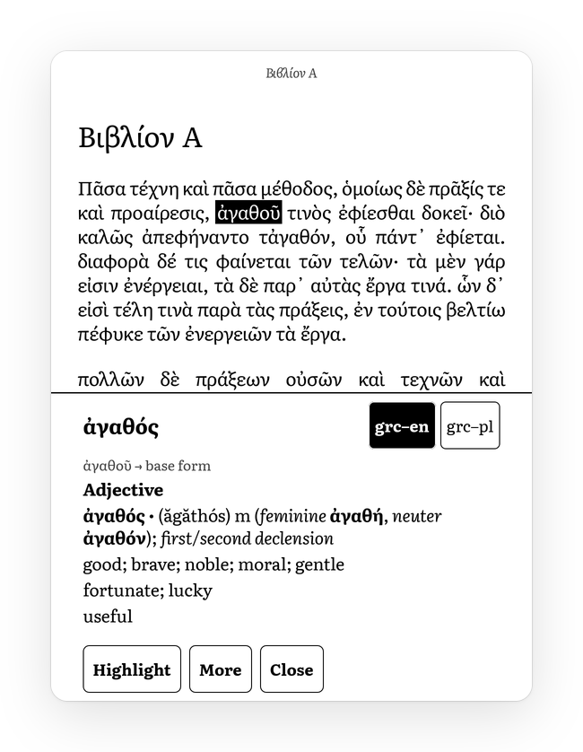

# The reader

The reader is two crates. `crates/aristotle-render` turns books into full-screen 8-bit pages with the document engine of [Plato](https://github.com/baskerville/plato) (`plato-core`) and uses none of Plato's Kobo UI. Its CLI, `aristotle-render`, renders pages to files on any host, shows them on the device and measures CPU and panel time. `crates/aristotle` is the reader app, binary `aristotle`. It takes the library from `aristotle-library`, pages from `aristotle-render` and screens from `aristotle-ui`, and reaches the hardware through `aristotle-hal`. The renderer does not depend on the UI or the library.

The reader opens EPUB, DRM-free MOBI 7, PDF and TXT, and runs on the device. Device measurements are in [`native-vs-aristotle.md`](native-vs-aristotle.md), "Device measurements of the app". Numbers here are host numbers unless marked [dev].

## Architecture

```text
aristotle-render (CLI: info, render, show, bench, turn, pages, place)
  └─ Book ─────────── plato-core
  │    EPUB, HTML ──── Plato's HTML engine (our font, Knuth–Plass, Liang hyphenation)
  │    MOBI ────────── mobi.rs → cached EPUB → Plato's HTML engine (MuPDF as fallback)
  │    PDF, TXT ────── MuPDF through Plato's PdfOpener (PDF scaled to fit)
  ├─ Page, Chrome ─── 1072 × 1448 buffer, stride 1088; header and footer drawn in the same frame
  └─ Screen ───────── aristotle-hal Framebuffer: blit the page, one full mode-9 update of the whole screen
```

| `aristotle-render` | Role |
| --- | --- |
| `style.rs` | Geometry and typesetting defaults (`Style::pw4`) |
| `book.rs` | Opening, engine choice, lazy pagination, chapters, words and links, rendering |
| `lang.rs` | Hyphenation language for EPUBs that declare several |
| `mobi.rs` | MOBI 7 decoder and EPUB writer |
| `page.rs` | Page buffers, the black and white frame, header and footer |
| `screen.rs` | The CLI's page turn on the panel |
| `position.rs` | Saved positions: EPUB spine coordinates, MOBI position maps |
| `notes.rs` | Footnote detection and text |
| `richtext.rs` | HTML fragments as styled paragraphs for popups |

| `aristotle` | Role |
| --- | --- |
| `main.rs` | Arguments, startup, the event loop, screens, menu actions |
| `panel.rs` | Pages and UI damage onto the panel, night mode, the menu overlay |
| `session.rs` | One open book: current page, rendered neighbours, restyle, labels |
| `turns.rs` | Turn, swipe, menu, hold and drag gestures |
| `shelf.rs` | The library screens' data: views, folders, series, sort, covers |
| `device.rs` | Clock, battery, storage, USB mode, versions |
| `progress.rs` | Locator mapping, write debouncing, the index writer |
| `pagecache.rs` | Page numbers on disk, background pagination |
| `snapshot.rs`, `open.rs`, `prewarm.rs` | Opening a book from a page snapshot |
| `prefs.rs` | `reader.json` |
| `reading.rs`, `overlay.rs`, `selection.rs` | Reading interactions and what they draw |
| `dict/` | StarDict, the fold index, base-form rules, the lookup thread |
| `marks.rs` | Highlights, bookmarks, export |
| `speed.rs` | Reading speed and the footer's progress line |
| `preview.rs` | `--preview`: the app on an in-memory panel |

### Threads

The PW4 has one core. The main thread runs the input loop, builds frames and renders pages. Work that could delay a turn runs elsewhere:

| Thread | Priority | Work |
| --- | --- | --- |
| `open` | normal, `SCHED_IDLE` once abandoned | Opens a book and renders the page and its neighbours |
| `paginate` | idle | Page numbers, on its own copy of the book |
| `prewarm` | idle | Snapshots of recent books while the library is idle |
| `warm-up` | idle | Loads hyphenation patterns while the library is shown |
| `index-saver` | normal | Writes `library.json` |
| `snapshot-writer` | nice 10 | Compresses and writes snapshots |
| `dict`, `dict-index` | normal, idle | Lookups; building missing indexes |
| `page-completions`, `panel-sequence` | normal | Waits for page updates; runs the menu's two-step overlay |

"Idle" is `SCHED_IDLE` plus nice 19 (`pagecache::lower_priority`). musl stubs `sched_setscheduler`, so the code makes the system call directly with a thread id. UI chrome goes through the HAL display thread (`aristotle_hal::display::Display`).

Plato's pages hold `Rc`s and FreeType fonts, which cannot cross threads. `Session::prepare` returns a result without them. Background opens take turns through the `OPEN_GATE` mutex, so an abandoned open drops its book before the next one lays out.

## How Plato is consumed

`plato-core` is not on crates.io and links about fifteen C libraries. Cargo builds it straight from the submodule at `third_party/plato/crates/core` and only reads the submodule.

`tools/build-plato.sh` builds the C libraries with Zig as static archives. It exports the submodule's commit with `git archive` into its `PLATO_BUILD` directory and builds there. The first host build takes about 6 minutes on 2 cores. `MUPDF_FONTS`, `MUPDF_FORMATS` and `PLATO_DJVU` choose what goes in (see [Size budget](#size-budget)).

The two crates are members of the root workspace but not of its `default-members`, so a plain `cargo build`, `cargo test` or `cargo clippy` at the root needs no C libraries. Cargo still reads `plato-core`'s manifest, so the submodule must be checked out. The release profile uses `opt-level = "s"`, with `plato-core`, `aristotle-render`, `paragraph-breaker` and `kl-hyphenate` at 3.

`tools/build-render.sh device|host` sets `PLATO_LIB_DIRS` and the Zig C compiler, builds both crates and assembles the bundle in `$ARISTOTLE_CACHE/render/<device|host>/`. `CARGO_CMD=clippy` or `CARGO_CMD=test` runs those instead. `PLATO_BUILD` selects the C build; the default is `plato-build/main` for the device and `plato-build/host-x86_64` for the host.

### Plato fork

[piotrkowski/plato](https://github.com/piotrkowski/plato), branch `aristotle`, is upstream Plato ([baskerville/plato](https://github.com/baskerville/plato), currently at `7da89f2`) plus one small, described commit per change:

| Commit | Change |
| --- | --- |
| `core: static musl link` | Static musl linking |
| `core: lib dirs and host musl` | `PLATO_LIB_DIRS` points `build.rs` at the archives of a `build-plato.sh` run; the x86_64 musl host target is accepted |
| `core: font symbols musl` | MuPDF's embedded-font symbol names on all musl targets |
| `core: epub language override` | `EpubDocument::set_language`, see [Hyphenation](#hyphenation) |
| `core: mupdf tofu fallback` | Links against a MuPDF without its Noto and CJK fonts |
| `core: optional djvu` | DjVu is compiled out when `libdjvulibre.a` is absent |
| `core: zip deflate only` | `zip` with deflate only |
| `core: lazy epub layout` | See [Lazy layout](#lazy-layout) |

To change Plato, commit inside `third_party/plato` on the `aristotle` branch, push to the fork, and commit the submodule bump here. Cargo builds the submodule's working tree, so the next `tools/build-render.sh` run picks up the change. Rerun `tools/build-plato.sh` with a fresh `PLATO_BUILD` only for changes to `thirdparty/` or `mupdf_wrapper/`. A fix to an earlier change is squashed into that change's commit.

To rebase on upstream, tag the current tip first, because Aristotle's history pins fork commits:

```sh
cd third_party/plato             # origin is the fork
git remote add upstream https://github.com/baskerville/plato.git   # once
git fetch origin && git fetch upstream
git checkout -B aristotle origin/aristotle
tag="aristotle-$(git rev-parse --short HEAD)"
git tag "$tag" && git push origin "$tag"
git rebase upstream/master       # resolve conflicts commit by commit
git push --force-with-lease origin aristotle
```

Then commit the submodule bump, update the C library pins in `tools/build-plato.sh` if upstream's `thirdparty/download.sh` changed, rebuild in a fresh `PLATO_BUILD`, and compare test results and rendered pages.

### Runtime data

Plato opens fonts, stylesheets and hyphenation patterns by relative paths, so both binaries change into their data directory: `data/` next to the binary, or `--data`.

| Path | Contents |
| --- | --- |
| `fonts/` | The 12 fonts Plato loads unconditionally, some cut down or stubbed; DejaVu Sans symbols and Noto Sans Coptic as glyph fallback |
| `serif/` | Literata, the body and UI font, from `crates/aristotle-render/assets/fonts/` |
| `css/` | Plato's `epub.css` and `html.css` |
| `hyphenation-patterns/` | `pl`, `en-us`, `en-gb`, `grc`, `la` from the Plato 0.9.45 release |

Downloads are pinned by SHA-256. The CLI keeps converted MOBI books in `cache/` next to the binary, or `--cache`.

## Building and testing

The host build links the same library versions built for x86_64 musl, so host pages match the device's apart from floating-point rounding.

```sh
. devloop/env.sh
PLATO_TARGET=x86_64-unknown-linux-musl PLATO_LIBS_ONLY=1 tools/build-plato.sh   # once
CARGO_CMD=test tools/build-render.sh host
tools/build-render.sh host
"$ARISTOTLE_CACHE/render/host/aristotle-render" render BOOK.epub 10 page.raw
"$ARISTOTLE_CACHE/venv/bin/python" -I devloop/host/fb2png.py page.raw page.png
```

`crates/aristotle-render/tests/navigation.rs` checks navigation, MOBI positions and lazy layout against a full pagination. `aristotle-render pages BOOK 20` prints all page starts plus 20 placements in fresh copies of the book, for diffing layout changes. `aristotle --library DIR --bench-open TITLE` times the open path without panel or touchscreen. Two tests are ignored by default: `real_dictionaries` needs real dictionaries, and `clippings_script` runs the script in `ARISTOTLE_CLIPPINGS_SCRIPT` on the export.

### Preview and device scenario

```sh
devloop/host/make-reading-test-epub.py BOOKS/proba-czytania.epub
"$ARISTOTLE_CACHE/render/host/aristotle" --data .../data --library LIB \
    --dict DICTIONARIES \
    --preview "$ARISTOTLE_CACHE/ui-preview/reading" BOOKS/proba-czytania.epub
```

The test book is a short Polish text written for it, with Greek and Latin words and two kinds of footnote. The preview drives the app on an in-memory panel with synthetic touches. It writes a PNG per step, `updates.txt` with each update's waveform and rectangle, the exported `My Clippings.txt`, and `reading.txt` with the same taps as an `aristotle-observe` scenario. Copy that into `devloop/kindle/scenarios/reading.txt` after layout changes; coordinates depend on the typography and the UI language. `devloop/kindle/scenarios/aristotle-open.txt` covers opening, turning, the menu and going back while a book opens.

### Running it on the device

```sh
. devloop/env.sh
PLATO_LIBS_ONLY=1 tools/build-plato.sh   # once
tools/build-render.sh device
ssh -F devloop/host/ssh_config kindle 'tar -xzf - -C /mnt/us' < "$ARISTOTLE_CACHE/render/aristotle-app-device.tar.gz"
ssh -F devloop/host/ssh_config kindle sh /mnt/us/aristotle/run-aristotle.sh [--turn-mode 7]
```

The app bundle unpacks to `/mnt/us/aristotle/` with `data/`, `run-aristotle.sh`, `takeover.sh` and `guard.sh`. It lives on the userstore because `/var/tmp` is a 64 MB tmpfs. `run-aristotle.sh` stops the stock GUI with `takeover.sh start`, runs the app, and restarts the GUI with `takeover.sh stop` (30 to 60 s of boot splash). `takeover.sh start` refuses anything but a PW4 on firmware 5.13.x unless `ARISTOTLE_FORCE=1`. Freezing the framework with SIGSTOP does not work: Amazon's watchdog killed it, and the GUI needed a reboot. The script ignores hangups and logs to `/var/tmp/aristotle.log`. Quit by holding the "Library" title for a second, or with `killall aristotle`.

The CLI's `show` and `turn` refuse to run while the stock framework (`cvm`) is up.

## Typesetting

| Setting | Value |
| --- | --- |
| Font | Literata 10 pt |
| Leading | 1.3 em |
| Alignment | Justified |
| Side margins | 5 mm (59 px) |
| Text block | 104 px from the top, 100 px from the bottom |
| Header | Chapter title, or the book title; Literata Italic 7 pt, gray 0x40, centred |
| Footer | Progress line left, `x / y` centred, percent right, 7 pt |

Literata was designed for e-reading. Its sturdy serifs and large x-height hold up in 16 grays, and it has all Polish letters and quotes. At 10 pt a line holds 42 to 45 characters, so some justified lines stay loose. Plato's 1.2 em leading felt cramped with Literata. Header gray 0x40 is below the black and white threshold (160), so the header survives in the A2 frame. Plato's margins are uniform, so `Book` shifts the layout area to place the text block and draws the chrome over the white margins. Plato's paragraph defaults apply: Knuth–Plass `total_fit`, hyphen penalty 50, stretch tolerance 1.26. The book's CSS is honoured.

The menu offers 8 to 15 pt in seven steps, line heights of 1.2, 1.3 and 1.5 em, and margins of 3, 5 and 8 mm (`FONT_PT`, `LINE_HEIGHT`, `MARGIN_MM` in `prefs.rs`).

### Hyphenation

Plato's patterns include Polish (`pl.standard.bincode`, minima 2 and 2). Plato picks patterns per element from `lang` or `xml:lang`, and otherwise from the book's first `dc:language`. Without a language it uses English.

Some EPUBs list the wrong language first. One Polish book listing `de-DE` first was hyphenated as German ("zobac-zymy"). For books that declare several languages, `lang.rs` samples 192 KiB of text, picks the declared language whose marker letters are most frequent, and passes it to `EpubDocument::set_language`. `aristotle-render --lang TAG` forces a language, and `aristotle-render info BOOK` prints the language and whether its patterns are loaded.

Plato loads all files in `hyphenation-patterns/` on first use, 5 to 9 ms on the host, so the bundle ships only five languages. The app loads them on the `warm-up` thread.

A trap not yet traced in Plato's code: in a Polish book, paragraphs marked `<p lang="grc" xml:lang="grc">` did not get the `grc` patterns. With `--lang grc` they did.

## Formats and positions

`mobi.rs` converts a DRM-free MOBI 7 book once to an uncompressed EPUB, because MuPDF's HTML layout has no Polish patterns and justifies poorly. It handles PalmDOC, UTF-8 and CP1252, images, `<mbp:pagebreak/>` chapter splits, and HTML that Plato's XML parser rejects. The language comes from EXTH 524 or the header's locale. `<a filepos=N>` links point to anchors `id="fileposN"`, as calibre writes them. DRM, HUFF/CDIC compression and KF8-only files fall back to MuPDF. `--no-convert` forces MuPDF. With a cached conversion, opening reads only the PalmDB header and record 0. `devloop/host/make-test-mobi.py` makes a MOBI 7 test book from an EPUB.

For Plato's engine a location is a byte offset into the book's text. Pages are found by walking `Location::Next`, which lays out a spine item as far as needed. For MuPDF documents, locations are page indices. `x / y` needs the whole book laid out, so `Book` also navigates by location (`page_start`, `next_page`, `previous_page`, `chapter_page`, `render_location`), and the footer leaves out the page number until `set_pagination` supplies the page starts.

Saved positions (`position.rs`) survive a new layout. EPUB positions are a spine item and an offset inside it. `Spine::read` repeats how `EpubDocument::new` builds the spine, since Plato keeps it private. Converted MOBI books store the stock Kindle position, a byte offset into the MOBI text, as `.mbs` sidecars do (`docs/library.md`). The converter records an anchor pair at least 200 bytes apart and stores them as `<book>.posmap` next to the cached EPUB. Positions in between are interpolated. Other formats store a fraction.

The EPUB can have more bytes than the MOBI text, so `PosMap::position` can map a page start back onto the previous page. Save page starts with `PosMap::position_at_or_after`.

## Opening a book

Plato finds page breaks only by laying out a chapter from its start. A MOBI without page breaks converts to one chapter, and placing a position in a long one took about 2 s on the device [dev]. The app avoids that by showing the page the reader left from a snapshot while the book opens on a worker.

### Snapshots

At each progress save, the current page and the prerendered next one go to `snapshots/<book id>.snap`, compressed with zstd level 1 (about 63 KB per text page instead of 1.5 MB). Each page carries its location, progress locator, menu labels and zstd's checksum.

The key covers the book id, the file's size and mtime from `stat`, a hash of the `Style`, the layout version, the app build, the runtime data and the progress locator. A snapshot is used only if all of them match, and is overwritten at the next save otherwise. Snapshots of books gone from the library are deleted at the next scan.

Copying the pages happens on the main thread. Compressing and writing happen on `snapshot-writer`, because an fsync on the FAT userstore took 79 to 379 ms on the device [dev].

The page chrome depends only on the location. Anything live added to it, such as a clock, must be left out of saved pages or redrawn before they are shown.

### The open path

1. On touch-down the tapped card inverts with A2. On release the snapshot is decoded (0.6 ms on the host) and goes out with one mode-8 flash.
2. The `open` worker opens the book, places it at the snapshot's page start, and renders that page and both neighbours.
3. Meanwhile turns move between the snapshot's two pages, and the menu opens with the stored labels. "Library" abandons the worker and saves the page shown as the progress. Holds, drags and link taps do nothing. Anything else that needs the book waits for it.
4. The main loop polls the worker every 10 ms. If the real page equals the snapshot's pixels at the same location, nothing is sent. Otherwise one full mode-9 update replaces it.

Without a snapshot the tapped card stays inverted while the worker opens the book, and the library keeps taking input. `prewarm.rs` makes that case rare: after 2 s without input on the library screen, it makes snapshots for the five most recent books that lack a valid one. Any touch cancels it between steps, and each book is tried once per run, position and style.

Going back to the library submits the library frame first, then copies the snapshot's pages, serialises the index and frees the book.

From a snapshot, a book is on the panel 557 to 570 ms after the tap [dev], against 0.8 s for the stock reader.

### Lazy layout

The fork's `core: lazy epub layout` commit lets Plato's block loop stop between two children of a block once two complete pages follow the requested location (`FIRST_LOOKAHEAD`), never inside a paragraph or table. `EpubDocument` keeps the parsed chapter and one frame per nesting level, and resumes 8 pages ahead (`LOOKAHEAD`) when a later page is needed. Resuming replays exactly what a full layout does, so page breaks do not move. Placing a position now costs time in proportion to how far into its chapter it is. In a 420 KB one-chapter novel on the host, placing took 9 ms at the start and 226 ms at 95 %, against about 230 ms anywhere before. Going back into a previous spine item still lays it out whole.

A change that should not move page breaks must leave the output of `aristotle-render pages BOOK 20` unchanged, and rendered pages must match byte for byte. Test it on one-chapter MOBIs and on books with nested blocks, lists and tables.

A restyle that lays out more than 48 KB of chapter text (`Session::slow_relayout`) shows a busy mark in the menu's top bar before the new page.

## Page turns and waveforms

Pages turn like the stock reader: one full-mode update of the whole screen with waveform mode 9. Partial updates, and A2 previews followed by GL16, left visible ghosting in real reading ([`native-vs-aristotle.md`](native-vs-aristotle.md), "Page-turn strategy experiment"). `--turn-mode 7` uses DU4: 317 ms instead of 503 ms on the device [dev], with fewer grays. The CLI's `--a2-preview` keeps the old two-step turn for experiments.

A tap turns when the finger lifts: the left 30 % goes back, the rest below the top 12 % forward. A tap or a swipe down in the top strip opens the menu. A horizontal swipe turns one page. Turning on touch-down saves 80 to 150 ms but makes a long press on a word turn the page first, so a hold never turns. After each submit the pages on both sides are rendered, about 106 ms on the device [dev], so a turn costs a memcpy and a submit.

The driver runs one update at a time and reads the framebuffer while processing it. A new page is blitted only once the previous page update has finished and the display thread is idle. That is the only place the input loop waits for the panel.

| What | Update |
| --- | --- |
| Page turn | Full mode 9, whole screen (or mode 7) |
| Opening a book, switching screens | Full mode 8, the stock flash |
| Library and settings | DU for black and white, GL16 for grays |
| Menu opening | A2 over its top bar and bottom sheet, then full-mode GL16 per part (`Panel::present_overlay`) |
| Menu closing, page changed behind it | Full mode 9, whole screen |
| Busy mark, bookmark ribbon | DU |

In night mode, turns and flashes stay the same and gray chrome uses GLKW16 instead of GL16. Pages are inverted in software by default, or by the EPDC with `--night-method hardware` (`docs/ui-framework.md`, "Night mode").

## The app

On start the app shows the library index at once, then scans `/mnt/us/documents` incrementally, one `stat` per file when nothing changed. The library has Books, Folders and Series views and a "Continue reading" card. Holding the "Library" title for a second quits. Screens and design are in `docs/ui-framework.md`, the index and scan in `docs/library.md`.

The settings screen controls the frontlight in 24 steps equal in CIE L* (`aristotle_hal::power::light_raw`), night mode, covers, the screensaver delay and the USB mode, which goes through `/var/local/aristotle/aristotlectl mode net` or `mode storage 10`.

After the screensaver delay the app saves, turns the light off and shows the current book as a card. A touch wakes it and does nothing else. The app holds `powerd`'s `preventScreenSaver` while it runs and does not suspend the CPU.

Each turn updates the progress in memory. The index goes to disk 3 s after the last turn, or at most 20 s after the first unsaved one, on `index-saver`, and also on going back to the library and on exit, SIGTERM and SIGINT included. Page numbers are cached per book and style in `/mnt/us/.aristotle/pages/`. On a miss, `paginate` computes them in the background and they appear from the next page on.

## Reading interactions

All of this lives in `reading.rs`, and the host preview drives the same code. Labels follow the UI language (`docs/ui-framework.md`, "Languages").

| Gesture | Result |
| --- | --- |
| Hold a word (500 ms) | Selects it and shows its definition in one update |
| Hold, then drag | Extends the selection with handles, A2 while moving; on release: Highlight, Dictionary, Translate, Cancel |
| Hold a highlighted word | The definition, with "Remove highlight" |
| Tap a footnote marker | The note in a popup; other links jump |
| Tap the top right 10 mm | Toggles a bookmark ribbon |
| Swipe on a popup or list | Its next or previous page |
| Menu → Contents, Highlights, Go to… | Lists and a position slider |

Links, enlarged to about 6 mm, and the bookmark corner are quiet zones where a tap does not turn.

Words come from Plato's display list (`Book::words`), one box per word or hyphenated piece. The finger picks the nearest word within 3 mm (`selection::hit`). A piece ending in a soft hyphen joins the next one. Selections drop punctuation and quotes at their ends, and their boxes are cut to the letters by an estimate. Selection boxes are inset vertically (`selection::line_boxes`) because Plato's boxes reach into neighbouring lines at 1.3 em.

### Updates on the panel

Anything that leaves residue behind is followed by a full update:

- A popup, the action sheet, a list or the "go to" sheet is built completely and sent as one update, full-screen mode 9 if it has grays (`App::present_full`).
- A selection growing under the finger is A2 on its boxes. If a lookup takes over 150 ms, the held word shows first.
- Closing anything over the page redraws the page with the page-turn update (`App::close_overlay`).
- Switching dictionaries and paging inside a popup are partial GL16 updates. The full update on close clears their residue.

Popups sit at the bottom, or at the top when the word is in the lower half, and are sized to their content between a quarter and three quarters of the screen. Their edge falls between two lines of the page.

### Dictionary



The app reads StarDict dictionaries (`dict/stardict.rs`) one folder deep under `/mnt/us/dictionaries`, `/mnt/us/koreader/data/dict` or `--dict DIR`. The language pair comes from the file name, as in `grc-pl.ifo`. The tested dictionaries are Wiktionary exports (xxyzz/wiktionary_stardict), which list inflected forms as synonyms and sort their files by Python's `str.lower()`. StarDict's own order cannot be assumed.

Lookups go through a fold index per dictionary (`dict/fold.rs`) in `dict-index/`. Keys are NFD with combining marks removed, lower case, and final sigma as sigma; `ł` stays a letter. Greek lookups ignore accents and breathings, and Polish ones ignore missing diacritics. An exact spelling beats words that only fold to the same letters. Missing indexes are built at idle priority. On the device that took 22.9 s for pl-pl and 37.2 s for grc-en, with a 66 MB memory peak [dev]. `aristotle --index-dicts --dict DIR --library OUT` builds them on the host to copy to `/mnt/us/.aristotle/dict-index/`.

Greek script picks Ancient Greek dictionaries, other text the book's language. Dictionaries into the UI language come first, then other Latin-script dictionaries. The switcher's choice is remembered per language in `dictionaries.json`.

`Dictionaries::lookup` tries the word and its listed forms, then a headword found in a later dictionary of the same language, then suffix rules (`dict/lemma.rs`) marked "≈ base form (guessed)", and finally offers the closest headwords. On the device a Polish lookup took 89 ms and a Greek one 10.5 ms [dev].

The popup shows only the senses until "More" is tapped. `dict::senses` drops Wiktionary sections such as examples, etymology and translations by their headings. Pronunciation lines are always dropped, because Literata has no IPA glyphs. A character the font lacks loses combining marks one at a time and becomes "…" as a last resort (`overlay::printable_text`). "Translate" glosses a selection word by word.

### Footnotes

`Book::footnote` (`notes.rs`) reads a link's target with Plato's XML parser and decides whether it is a note. It looks for EPUB 3 and DPUB-ARIA semantics on the link or target (`noteref`, `footnote`, `endnote`, `doc-footnote`), common ids and classes (`fn3`, `note-3`, `przypis3`, calibre's `filepos12345`, Wolne Lektury's `annotation-3`), and marker link text (`1`, `[12]`, `iv`, `*`, `†`). The note text is the target block, the paragraph of an empty anchor, or the text up to the next anchor when one block holds many notes. Back links are dropped and notes are cut at 2,400 characters.

### Highlights, bookmarks and export

Highlights and bookmarks are annotations in the library index with source `aristotle`. They store renderer positions that survive a new font size (`epub:<spine item>:<offset>`, `kindle:<position>`, `page:<i>`), Kindle locations of 150 bytes, the chapter and the local time. Adding or removing one redraws the page and refreshes its snapshot.

Each new highlight is exported at once (`aristotle-library` `export`):

- It is appended to `/mnt/us/documents/My Clippings.txt` in the stock reader's en_GB format, so tools that import that file keep working. The labels stay English in any UI language. Only missing entries are written, and deleting a highlight leaves the file alone, as on the stock Kindle. The setting "Save highlights to My Clippings.txt" (`clippings`) turns this off.
- `/mnt/us/aristotle-notes/<Title — Author>.md` is rewritten as an Obsidian-style note with the book's highlights.

Tests and scenarios must start the app with `--test-clippings PATH`, which writes there instead of the user's `My Clippings.txt`. Notes on highlights wait for an on-screen keyboard. The data model and the export already carry them (`Annotation::note`, written as "Your Note").

### Progress line and navigation

The footer's left side shows the chapter and the minutes left in it: "Ch. 3/12 · 7 min". Chapters are the first-level contents entries, located without layout (`Book::chapter_info`). Reading speed is an exponential average over forward turns of 5 s to 10 min (`speed.rs`, stored in `reading.json`), starting at 75 s per page. "Go to…" offers a slider and ±1 and ±10 % steps.

## Settings and files

`reader.json` holds global preferences. Unknown or missing fields fall back to the defaults.

| Field | Default | Meaning |
| --- | --- | --- |
| `size`, `spacing`, `margins` | 2, 1, 1 | Indexes into `FONT_PT`, `LINE_HEIGHT`, `MARGIN_MM` |
| `turn_mode` | 9 | Page-turn waveform, 9 or 7 (`--turn-mode`) |
| `night`, `night_method` | false, `software` | Night mode and how it inverts (`--night-method`) |
| `covers` | `none` | `none`, `cards` or `photos` |
| `sleep_minutes` | 15 | Screensaver delay; 0 is never |
| `library_view`, `sort` | 0, 0 | Books, folders or series; recent, title or author |
| `language` | `en` | UI language (`--lang`) |
| `clippings` | true | Append highlights to `My Clippings.txt` |

The frontlight level is not stored; the app reads it back from the LM3695.

The library data directory is `/mnt/us/.aristotle` (`--library DIR` or `$ARISTOTLE_DATA`). Besides `library.json` and the covers it holds `reader.json`, `reading.json`, `dictionaries.json`, `dict-index/`, `pages/<book id>-<key>.txt` (page starts keyed by style, file size and mtime, and `LAYOUT_VERSION`), `snapshots/` and `epub-cache/` (converted MOBI books and position maps). `aristotle --help` lists all options.

## Timing log

The app writes `[perf <ms since start>]` lines to stderr, which `run-aristotle.sh` sends to `/var/tmp/aristotle.log`. The main ones:

| Line | Meaning |
| --- | --- |
| `startup: first frame submitted` | Process start to the library's first frame |
| `scan: ...` | Scan time and what changed |
| `open: "<title>": snapshot submitted after N ms` | Tap release to the snapshot's flash |
| `open: "<title>": book ready N ms after the tap ...; snapshot Same\|Chrome\|Page` | The worker's result; anything but `Same` sent a correcting update |
| `open: ... no snapshot` | An open without a snapshot, with its steps |
| `turn <dir>: tap->submit` | Release to submit, whether prerendered, the wait for the previous update |
| `panel: <what> on the panel N ms after submit` | Update completion reported by the driver |
| `paginate`, `snapshot`, `prewarm`, `index`, `dict` | Background work |
| `hold: ...`, `link ...`, `highlight: ...`, `export: ...` | Reading interactions |

## Size budget

The default device build covers Polish and English, some Ancient Greek and Latin, as EPUB, MOBI, PDF and TXT, without DjVu or CJK. It is 9.64 MB for `aristotle` and 6.66 MB for `aristotle-render`, stripped, with 2.68 MB of data and a 6.4 MB app tarball.

| Switch | Default | Effect |
| --- | --- | --- |
| `MUPDF_FONTS` | `latin-greek` | The 14 standard PDF fonts plus Noto Serif. `base14` drops Noto Serif; `full` restores Plato's set (+17 MB) |
| `MUPDF_FORMATS` | `minimal` | PDF, images, MOBI fallback and TXT. `full` adds XPS, SVG, CBZ, FB2, Office, HTML and EPUB |
| `PLATO_DJVU` | 0 | 1 builds and links DjVuLibre |
| `FONT_SUBSET` | `latin-greek` | Literata and Noto Sans cut to Latin and Greek. `none` ships them whole |
| `HYPH_LANGS` | `pl en-us en-gb grc la` | Hyphenation patterns in `data/` |

The first three are `build-plato.sh` switches and switch in place: MuPDF gets one output directory per font and format choice, and `PLATO_DJVU` only changes what is linked. The last two belong to `build-render.sh`. Other C library changes need a new `PLATO_BUILD`. The C libraries are also built with function sections, `zip` keeps only deflate, and FreeType drops unused modules.

Noto Serif stays, through the patch `tools/mupdf-patches/mupdf-0001-keep-noto-serif.patch`, because MuPDF's reflowed text (TXT, and MOBI the converter can't take) needs it for polytonic Greek. Plato's engine gets two small fallback fonts instead of MuPDF's Noto set, so characters Literata lacks, CJK included, show a `.notdef` box. Libertinus Serif ships as a one-glyph stub because `Book` replaces it with Literata. Source Code Pro and Parisienne stay unmodified because their licences reserve their names.

On the host, `opt-level = "s"` everywhere cost about 5 % per page and `"z"` 75 %; the split profile stays within noise of level 3. `-C target-cpu=cortex-a9` is safe but off until a device benchmark shows a gain. The largest remaining parts are MuPDF (1.7 MB, 0.9 MB of it fonts), the UI rasteriser stack (0.7 MB), HarfBuzz, FreeType, `regex` and MuPDF's HTML parser Gumbo.

## Known limitations

- Plato has no glyph cache and keeps the display lists of all laid-out chapters. Memory during background pagination, with two copies of a book open, has not been measured.
- Dictionary indexing on the device peaks above the 40 MB memory target [dev]. Build large indexes on the host.
- Lazy-layout timings are from the host.
- A2 legibility of inverted selections and ghosting from partial updates inside popups are not yet checked on the panel.
- Single-letter Polish words (a, i, o, u, w, z) can end a line. Keeping them with the next word needs a non-breaking-space pass before layout.
- MOBI books have no table of contents yet, and HUFF/CDIC books are not converted.
- Plato's engine ignores `margin: auto` centring of images.
- A highlight across a page break ends at the page's last word.
- The library clock relies on musl reading `/etc/localtime` when `TZ` is unset [inference].
