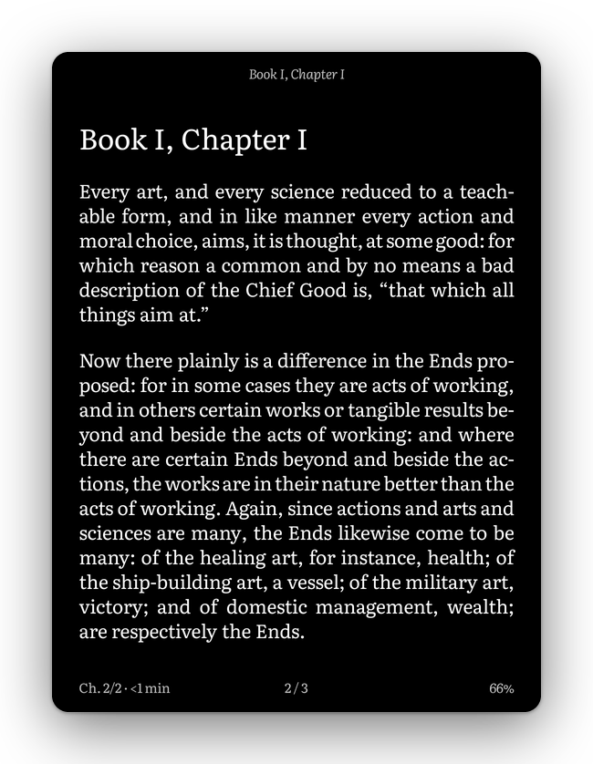
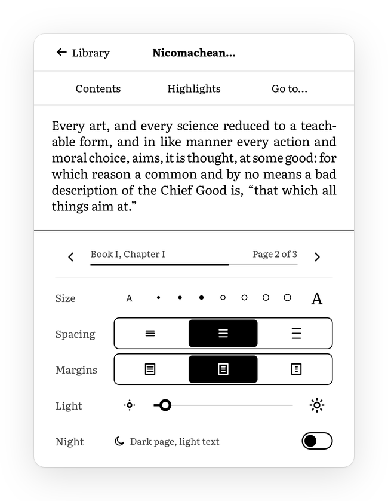
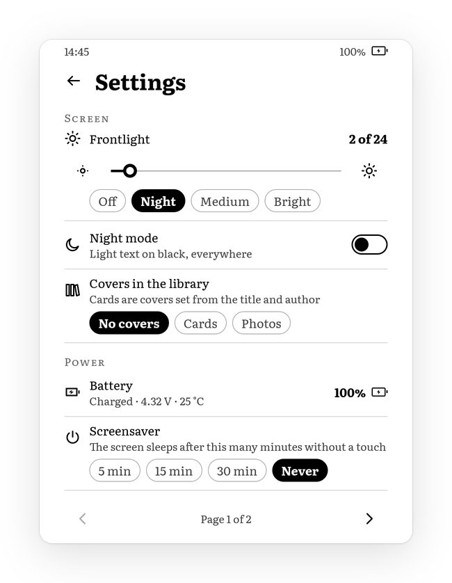

# UI framework: aristotle-ui

`crates/aristotle-ui` is Aristotle's own UI toolkit: a small, retained, pure-Rust UI designed for the PW4's e-ink panel. It draws into an 8-bit gray canvas, works out the smallest rectangles that changed and the waveform each one needs, and turns raw touch events into gestures. It does not depend on `aristotle-hal`, so it builds and tests on the host, and a desktop preview renders every screen to PNG.

Status: the toolkit and its screens (library with folders, series and shelves; settings; screensaver; reader page and menu) work on the host, cross-compile for the device and are wired into the reader app (`docs/reader.md`). Night mode, the settings controls, the folder views, the menu's two-step overlay and the busy mark are new and still need their first device run; see [Open issues](#open-issues) and the scenario `devloop/kindle/scenarios/aristotle-ui.txt`.

## Architecture

```
touch events ──► input::GestureRecognizer ──► Ui::handle_touch ──► UiEvent (Action, Tap, Swipe…)
                                                   │                      │
                                                   ▼                      ▼
                                           press feedback (A2)     screen code mutates the Tree
                                                                          │
Tree (nodes, layout, paint, hit test) ◄───────────────────────────────────┘
   │
   ▼
Ui::render ── layout ─► candidate rects ─► repaint into Canvas ─► diff against front ─► Damage {rect, Waveform}
                                                                                              │
                              device: Canvas::blit_into(framebuffer) + Display::damage ◄──────┘
                              host:   PNG via aristotle-ui-preview
```

| Module | What |
| --- | --- |
| `canvas` | `Canvas { width, height, stride, pixels }`, 0 black, 255 white, explicit stride like the framebuffer (1088 bytes per 1072-pixel line on the device). Clipped `Painter` primitives, zeno-rasterized paths, pixel diffing, black-and-white detection, 16-level quantization. |
| `geom` | Integer `Rect`, `Size`, `Insets`; `mm()` and `pt()` at 300 DPI; `MIN_TARGET` = 9 mm = 106 px. |
| `waveform` | `Waveform::{A2, DU, GL16, GC16}` with the Zelda numbers of `aristotle_hal::framebuffer::Waveform` (6, 1, 3, 2), without depending on the HAL. |
| `text` | Fonts and families, swash shaping and hinted rasterization, hyphenation, Knuth–Plass paragraph layout. |
| `tree` | The retained node tree: box-constraint layout, painting, hit testing, mutation that records damage. |
| `ui` | `Ui`: owns tree, text engine, canvas and the copy of what the panel shows; computes damage; dispatches gestures. |
| `input` | Tap, long press and swipe recognizer over `(phase, id, x, y, time_us)` events. |
| `icons` | One family of 37 outline icons on a 24-unit grid ([Icons](#icons)). |
| `widgets` | Custom leaves: typographic cover card, battery, busy mark, toggle, slider, size steps. |
| `theme` | The design tokens: grays, spacing, type scale, icon sizes ([Design system](#design-system)). |
| `screens` | `library` (home, views, folder and series shelves), `settings`, `sleep` (screensaver), `reader` (page and menu); the app feeds them real data, the preview and tests sample data. |

### The tree

Nodes live in an arena (`Vec<Node>`, addressed by `NodeId`). Kinds: `Column`, `Row` (with `gap`, cross-axis alignment and `flex` children), `Stack` (overlays), `Padding`, `Align`, `Fixed`, `MinSize`, `Text`, `Icon`, `Rule`, `Progress`, `Spacer`, `Pages` and `Custom(Box<dyn Widget>)`. Any node can carry a background, a rounded border, an `action` and a press `Feedback` (invert, outline or none).

Layout is one pass of box constraints, as in Flutter: the parent passes minimum and maximum sizes, the child chooses its size, the parent positions it. It is linear in the number of nodes; paragraph layouts are cached per width, so relayout after a text change only reshapes that paragraph.

`Pages` is the list widget. It fills one page with as many children as fit and hides the rest; `set_page` turns it. There is deliberately no scrolling container (see below).

Mutations go through the tree (`set_text`, `set_progress`, `set_hidden`, `set_page`, `set_inverted`, `widget_mut` + `invalidate`) so every change is recorded with a refresh class.

## E-ink UX principles

These rules shaped both the toolkit and the screens.

1. **Pages, never scrolling.** Every scroll step would be a panel update of 120 to 550 ms that leaves ghosting. A page turn is one clean update, and the user always knows where they are ("Page 1 of 3"). Lists use `Pages`; the reader paginates.
2. **Feedback on touch-down, in A2.** The gesture recognizer emits `Press` on the first contact, before it knows the gesture, and `Ui` inverts (or outlines) the target at once with A2, the 120–144 ms waveform. When the finger lifts, the real result is already on its way. If the finger travels, `Cancel` withdraws the highlight.
3. **9 mm targets.** Every action is at least 106 × 106 px, and smaller visual elements are hit-tested as if they were (`Rect::expand_to`). On e-ink a missed tap is expensive: you wait a full refresh to see that nothing happened.
4. **Black, white and few grays.** The panel shows 16 levels and light grays wash out under the frontlight. Hierarchy comes from size, weight and space; the lightest text is `INK_3` (0x66). Controls are solid black and white, so their state changes qualify for DU. Progress fills are plain rectangles without anti-aliased ends, so a progress step is a DU update a few pixels wide.
5. **The result is the feedback for big gestures.** Reader tap zones and swipes do not highlight anything; the new page is the response.
6. **Calm screens.** Generous 6 mm margins, one title per screen, no badges, no carousels, nothing that exists to sell something.
7. **Night mode by inversion.** Every screen is drawn once, in day colours; night mode inverts the final pixels ([Night mode](#night-mode)), so anti-aliasing stays correct and no screen needs a night variant.
8. **One action, one coherent update.** See [Transitions](#transitions).

## Text

### Font engine choice: swash

The candidates were evaluated by what they do for this device; sizes below are from our own armv7 build where marked, otherwise from crate scope (not measured).

| Crate | Shaping | Hinting | Rasterizer | Notes |
| --- | --- | --- | --- | --- |
| **swash** (chosen) | OpenType GSUB and GPOS: kerning pairs and classes, ligatures, marks, `smcp`, `onum`, `locl` | Yes, through skrifa (TrueType interpreter and autohinter) | Yes (zeno) | One crate for shaping, scaling and rendering. Measured on armv7: swash 243 KiB plus skrifa 271 KiB of `.text`. |
| rustybuzz + ttf-parser | Best available (HarfBuzz port) | No | No | Needs a separate rasterizer and still no hinting; two outline parsers in the binary. |
| cosmic-text | Via a HarfBuzz port | Via swash | Via swash | A full desktop text stack (font discovery, bidi, editing). Larger, and its greedy layout leaves no room for our justification. |
| fontdue | No (legacy `kern` table only) | No | Yes, small and fast | Literata, Charis and Gentium kern through GPOS, so fontdue would set them unkerned and without ligatures. |

swash gives the best quality per byte: real OpenType shaping and hinting in one pure-Rust dependency, and zeno, its rasterizer, also draws our icons and rounded shapes at no extra cost.

Hinting mode: swash 0.2 hints through skrifa in "smooth" mode, which snaps vertical features (baseline, x-height, horizontal stems) to the pixel grid and keeps horizontal metrics linear. That suits a 300 DPI panel: crisper x-height in 16 grays, while justified lines keep exact widths and glyphs sit at quarter-pixel horizontal positions (cached per phase).

Darkening: coverage goes through `coverage^0.8` (`TextEngine::set_darkening`). Unadjusted anti-aliased text looks thin and gray on e-ink next to the stock reader.

### Fonts

Bundled in `crates/aristotle-ui/assets/fonts/`, each with its OFL text:

| Family | Styles | Licence | Role |
| --- | --- | --- | --- |
| Literata | Regular, Italic, Bold, Bold Italic | SIL OFL 1.1 | UI and default reading face, compiled in (`embedded-fonts` feature, 1.22 MiB) |
| Charis | Regular, Italic | SIL OFL 1.1 (Reserved Font Names "Charis", "SIL") | Alternative reading face, loaded from disk |
| Gentium Book | Regular, Italic | SIL OFL 1.1 (Reserved Font Names "Gentium", "SIL") | Alternative reading face, loaded from disk |

The OFL allows bundling and redistribution with any software, AGPL included, as long as the fonts are not sold on their own and keep their licence; the reserved names only matter if we modify the fonts. Missing styles are synthesized: a missing bold is emboldened outlines (advances widened to match), a missing italic a 12° slant. A test checks that every bundled face covers `ĄĆĘŁŃÓŚŹŻąćęłńóśźż„”«»–—…`.

### Paragraph layout

`text::layout_paragraph` turns styled spans into lines:

1. Spans are flattened; soft hyphens (U+00AD) are removed and remembered as hyphenation points.
2. Break opportunities come from UAX #14 (`unicode-linebreak`), so dashes, quotes, slashes and non-breaking spaces behave as Unicode specifies.
3. Each segment is shaped whole (kerning inside a word survives hyphenation) and becomes Knuth–Plass items: boxes, stretchable glue for spaces, and penalties for hyphenation points and explicit hyphens. A hyphenation point inside a ligature cluster is skipped.
4. **Justified** text is broken with Knuth–Plass total fit, which chooses all breaks of a paragraph together to minimise uneven spacing, with penalties for hyphens, consecutive hyphens and tight-next-to-loose lines. If no solution fits the tolerance it retries looser, then falls back to first fit. **Ragged** text (UI labels) uses first fit, optionally **balanced** for headings (narrowest width with the same line count, so a title does not end in one lonely word).
5. Polish rules: a one-letter word (a, i, o, u, w, z) and an initial ("S.") never end a line.
6. `max_lines` truncates with an ellipsis, cutting inside a word if needed.

Hyphenation is a hook: `trait Hyphenator { fn hyphenate(&self, word, out) }`. `PolishSyllables` is a rule-based syllable hyphenator (digraphs, softening *i*, onset rules: Kra-kow-skie-go, pań-stwo, sio-stra, przy-szło-ścią); Polish spelling allows splitting consonant clusters almost anywhere, which makes a syllable rule unusually safe. It does not know prefixes (rare errors like *prze-dmie-ście* are possible). A pattern-based (Liang) hyphenator can implement the same trait.

The reader adds book typesetting on top: chapter sinkage, small-caps chapter number, balanced italic title, no indent after a heading, old-style figures, and pagination that keeps headings with the following text and never leaves an orphan or a widow (a page may end one line short instead).

## Damage and waveform hints

`Ui::render()` returns `Vec<Damage { rect, waveform }>`:

1. **Candidates.** Each recorded change contributes its node's rectangle (a target's whole box for press feedback); every painting node whose rectangle moved, appeared or disappeared during layout contributes the old and the new rectangle. Hiding or showing a subtree therefore damages only the nodes inside it that actually paint: opening the reader menu touches the two bars, not the page between them.
2. **Repaint.** Each candidate is repainted from the tree into the canvas with the painter clipped to it. Transient (press) regions are processed first, then larger before smaller.
3. **Tighten.** The repainted region is compared with `front`, the copy of what the panel shows. Only the bounding box of pixels that differ becomes damage; a repaint that produces the same pixels produces nothing. Rects already covered by a more faithful one are dropped. The result is available as `Ui::minimal_damage()`.
4. **Waveform per rect**, from why it changed:

   | Cause | Waveform | Why |
   | --- | --- | --- |
   | Press feedback (`Refresh::Transient`) | A2 (6) | Fastest, black and white only; replaced moments later. |
   | Content change whose new pixels are all 0 or 255 | DU (1) | Clean black and white at 309 ms instead of 544. |
   | Content change with grays (anti-aliased text, images) | GL16 (3) | 16 levels, no flash. Also used to restore after A2. |
   | New screen (`set_tree`), night mode, every 6th page turn | GC16 (2), full screen | Flashing refresh that clears accumulated ghosting. |

5. **Coalesce** (`Ui::coalesce`, default `Coalesce::Single`). The stock driver runs one update at a time and blocks while one is on the panel (`docs/eink-rendering.md`), and an update costs about a whole waveform whatever its size. So by default all non-A2 damage goes out as one rectangle with the most faithful waveform, and A2 feedback as a separate, first update. GL16 leaves unchanged white pixels alone, so the larger rectangle has no visible cost. `Coalesce::Nearby` (merge only overlapping or nearly adjacent rects) and `Coalesce::None` exist for a future driver that runs updates in parallel.

Rebuilding a screen does not need a flash: `Ui::set_tree_with(tree, Refresh::Auto)` repaints everything and sends only the pixels that differ, which is how the reader applies a new font size.

### Device hand-off

```rust
for d in ui.render() {
    ui.screen().blit_into(d.rect, fb_pixels, fb_stride);
    display.damage(hal_rect(d.rect), Waveform(d.waveform.mode()), &[]);
}
```

`aristotle_hal::display::Display` coalesces whatever arrives while the panel is busy, so the input loop never blocks. Touch events convert field by field from `aristotle_hal::input::TouchEvent`; poll with `ui.next_deadline(now)` as the timeout and call `ui.tick(now)` so a long press fires while the finger is still down.

## Input

`GestureRecognizer` thresholds (all in device pixels at 300 DPI): tap slop 4 mm, long press 500 ms, swipe at least 8 mm along a dominant axis (1.5 × the other). A second finger cancels the press and the rest of the touch is ignored (reserved for pinch). A long press is detected either by `tick` or, failing that, by the next event's timestamp.

Reader zones: the top 12 % opens the menu, the left 30 % goes back, the rest goes forward, because most turns are forward and that target should be the largest. Swipe left and right turn pages, swipe down opens the menu. While the menu is open, a tap on the visible page closes it.

## Design system

The look in one sentence: a quiet book-like page in Literata, black on white (or white on black at night), with one title per screen, generous margins, hairlines instead of boxes, and controls that are solid black and white. The tokens live in `theme.rs`; screens use nothing else.

### Type scale

All in Literata, in points (so 300 DPI px = pt × 300 / 72):

| Token | Size | Weight | Used for |
| --- | --- | --- | --- |
| `DISPLAY` | 15 pt | bold, 1.15 | The one title of a screen: "Library", "Settings" |
| `HEADLINE` | 12 pt | bold, 1.15 | The book to continue, a folder's or series' name |
| `TITLE` | 11 pt | bold, 1.2 | Screensaver caption, prototype menu |
| `ITEM` | 9.5 pt | bold, 1.15 | The first line of a list row (book title, folder name) |
| `UI` | 8.5 pt | regular, 1.3 | Tabs, chips, labels, buttons, setting names |
| `SMALL` | 7.5 pt | regular, gray `INK_2` | Authors, values, hints, the status line, the pager |
| caps | 7.5 pt | small capitals, +8 % tracking, `INK_3` | Section labels: "Continue reading", "Screen", "Power" |

The ratio between neighbours is about 1.15, with a jump to the display size so a screen has exactly one dominant line. Percentages are written without a space ("82%"); dates, numbers and sizes follow the UI language ("Saturday, 17 October 2026" and "4.1 GB" in English, "sobota, 17 października 2026" and "4,1 GB" in Polish; see [Languages](#languages)).

### Spacing

An 8 px unit (0.68 mm): `Space::XS` 8, `S` 16, `M` 24, `L` 32, `XL` 48, `XXL` 64. Side margins are 6 mm (71 px). Every target is at least 9 mm (106 px) in both directions; list rows are 151 px (text only) or 141 px (folders, series), so four to five fit a page under the home screen's header. The status line is 5.5 mm tall.

### Grays and the night palette

Every gray is one of the panel's 16 levels (a multiple of 17), checked by a test:

| Token | Day | Night (inverted) | Use |
| --- | --- | --- | --- |
| `INK` | 0x00 | 0xff | Text, icons, controls |
| `INK_2` | 0x44 | 0xbb | Secondary text |
| `INK_3` | 0x66 | 0x99 | Captions, small capitals, the lightest text allowed |
| `RULE` | 0xaa | 0x55 | Hairlines, inactive tracks and chip outlines |
| `TONE` | 0xdd | 0x22 | Quiet fills |
| `PAPER` | 0xff | 0x00 | Background |

Night mode mirrors the palette exactly rather than using a second, softer one: white text on black is the most legible night page; pure black and white chrome stays pure black and white and keeps qualifying for DU; and an e-ink panel reflects light, so full-white text does not glare the way it does on a backlit screen. The frontlight sets the brightness.

### Components

- **Status line:** the time at the left; percentage and battery at the right (the battery draws a bolt while charging). A hidden busy mark sits in its middle ([Transitions](#transitions)).
- **Header:** the display title with the settings gear, or on a shelf a back arrow, the shelf's name in headline size, "Folder · 3 książki" and the sort button.
- **Tabs** ("Books", "Folders", "Series"): text with a 5 px black underline under the chosen one.
- **Chips** (shelves, presets, choices): pill-shaped; the chosen one solid black with white bold text, the others a 2 px `RULE` outline. They answer touch-down by inverting.
- **List rows:** title, author, then a status line (progress bar and percentage, "✓ Finished", "New" in small capitals, or "Series · vol. 2"); a 1 px `RULE` hairline below. Folder and series rows carry their icon and a chevron.
- **Cards** (optional covers, `widgets::Cover`): see [Covers](#covers).
- **Toggle, slider, size steps:** solid black and white, so a change is DU.

### Covers

The library shows no covers by default; the settings offer "No covers", "Cards" (typographic cards) and "Photos" (the books' own covers where they have one, cards otherwise). A card is one of four bindings, background and ink: white with black (and a 2 px edge), 0x22 with white, 0xdd with black, 0x55 with white. The binding is picked by a stable hash of the book's series or else its folder, so an author's folder or a series reads as one set on a shelf, and the four stay distinct in night mode. A large card (150 px wide and up: the book to continue, the screensaver) has an inner 2 px frame like a blocked cloth binding, "Volume 3" in small capitals for a series, the title in bold and balanced lines (shrunk until its longest word fits, since cards are not hyphenated), a short rule, and the author in small capitals at the foot. A small card (list rows, 72 × 106 px) is an italic monogram with the series number in a corner. Previews: `covers.png`, `covers-night.png`.

## Icons

One family of 37 icons (`icons::Icon::ALL`): library, back, menu, settings, search, font (Aa), brightness, dim, night, bookmark (outline and filled), folder, series, sort, contents, close, the four chevrons, more, battery, charging, USB, info, storage, clock, sleep, plus, minus, check, and the three spacing and three margin glyphs of the reader menu. Sheet: `icons.png`, `icons-night.png`.

- **Grid:** 24 × 24 units with a 2-unit safe border (live area 2 to 22). Outlines with round caps and joins; fills only where a shape must read as solid (more, filled bookmark, the battery level, the USB plug).
- **Stroke:** one weight for the family, in whole device pixels per size: 3 px up to 36 px icons, 4 px at 44 to 52 px, 5 px at 56 to 68 px, 6 px above (`icons::stroke_px`). Small icons are thus relatively heavier (2.25 units at 32 px, 2 at 48 px): optical sizing, so the status line's battery does not look thinner than the toolbar.
- **Sizes:** 48 px is the standard (`IconSize::STANDARD`, 4 mm), 36 px for inline marks and the status line, 60 px for emphasis. At 48 px one unit is 2 px and the 4 px stroke centred on whole units covers whole pixels, so horizontal and vertical strokes are pure black without an anti-aliased edge (a test checks the menu icon): sharp at 300 DPI, and they survive A2 and DU.
- Icons sit centred in 9 mm buttons (`screens::icon_button`) and invert with them on touch-down.

## Night mode

Night mode shows every screen, the library, the reader page, the menu and the settings, as white on black. It is one switch (the "Night" row of the reader menu and "Night mode" in the settings), stored in `reader.json`.

<p>
  
  
</p>

### How the screen is inverted

The EPDC can invert in hardware: `EPDC_FLAG_ENABLE_INVERSION` (0x01 in FBInk's `mxcfb-kindle.h`) in an update's `flags` makes the PXP invert the region on its way from the framebuffer to the panel; FBInk reports `canHWInvert=1` for our unit and KOReader treats it as safe on mxcfb Kindles. The alternative is to invert our own pixels. Both are implemented:

| | Software (default) | Hardware (`--night-method hardware`) |
| --- | --- | --- |
| What is inverted | The UI canvas (`Ui::set_night`) and book pages, inverted in the copy to the framebuffer (`Framebuffer::blit_inverted`) | Nothing in memory; every update carries the flag (`Framebuffer::set_hw_invert`, shared with the display thread's `Updater`) |
| CPU cost | The page copy is memory-bound, so the fused copy-and-invert costs about what the plain copy does; UI repaints invert their dirty rectangles | None |
| What the panel receives | 255 − v per pixel | 255 − v per pixel (the PXP does it) |
| Screenshots of `/dev/fb0` | Show the night picture | Show the day picture |
| Failure modes | None known | Any update sent without the flag (another process, a forgotten path) shows that region in day colours; behaviour of the flag with the Lab126 ghost-reduction steps is untested |

The panel ends up driven with the same pixel values and the same waveforms either way, so ghosting should not differ, and software inversion is the default because it is self-contained: what the UI's copy holds, what the framebuffer holds and what the panel shows are the same, the host preview is exact, and nothing depends on a flag reaching every submit. Hardware inversion stays as an option for a direct comparison on the panel. Snapshots and the page cache keep day pixels in both cases; the inversion happens only on the way to the panel.

### Waveforms at night

The clean-turn rule does not change: a page turn is one full update of the whole screen in mode 9, a flash one full update in mode 8. These are the two waveforms FBInk calls night waveforms (GLKW16, GCK16), which the stock UI already uses by day on the PW4. At night the only change is for gray chrome: GL16 partial updates become GLKW16 partial updates (mode 9), the gray waveform for dark pages that KOReader uses as `waveform_night` on Rex and Zelda devices. DU and A2 stay as they are. All of this is `panel::plan` in the reader, tested on the host.

Switching is one full mode-8 flash into the new state, whatever screen is shown. The driver has a night-mode ioctl (`MXCFB_SET_NIGHTMODE`) that dims the frontlight during GCK16 flashes; it is not used (untested, and FBInk notes nothing uses it).

## Transitions

The rule: nothing may look buggy. Each user action becomes one coherent update of the final state on the panel.

1. **Build the whole frame, then submit once.** A screen is built and laid out completely (covers read, battery and clock sampled, the list's page set) before `Ui::render`; no blank-then-content, no second pass a moment later. Two exceptions, both not caused by a tap: the library is rescanned after the first frame of a run, so books added over USB appear with one partial update if anything changed; and the status line's clock is redrawn once a minute (a small partial update of the digits).
2. **Acknowledge on touch-down.** Every control inverts at once with A2 (about 120 to 144 ms on the panel). A2 rather than DU because DU takes about 309 ms, beyond the 150 ms target; the A2 inversion never stays, the result replaces it. Rows with cover photos get a heavy frame instead, so a photo never turns into a negative. When an action will take longer than about 300 ms (the first open of a MOBI or AZW3 book, which converts it), the busy mark (a black tab with three white dots, pure black and white) appears in the status line with the release, as one small DU update.
3. **One refresh class per kind of change.** A screen switch is exactly one full mode-8 flash. An in-screen change (shelf chip, view tab, sort, toggle, slider, settings choice, list page) is one partial update of the changed region, DU if it is black and white, GL16 (GLKW16 at night) if it has grays. List pages flash only when cards or cover photos were on the screen, because their large grays ghost; a text list never does. Never two flashes for one action.
4. **Overlays appear and go in one step each, with crisp edges.** The reader menu's top bar and bottom sheet are opaque white with a 2 px black rule at their inner edges. Their edges move into the white between two lines of the page (`screens::reader::mask_extents`), so no line is cut through its letters. Opening shows the menu in about 150 ms as one A2 update over both parts (partial, so the page between them is not touched), followed by one full-mode gray update of each part alone, which brings the grays and clears what A2 left (`Panel::present_overlay`, on a sequencer thread so input never waits). A single gray update over the bounding box of both parts would cover almost the whole page and show nothing for a full waveform. Closing restores the page with one full mode-9 update, like a page turn.
5. **Night switch:** one flash into the inverted state.

`crates/aristotle-ui/tests/transitions.rs` checks rules 1 to 3 and 5 on the host from what `Ui::render` returns, and `panel::plan`'s tests check how each hint becomes an EPDC request. On the device, `devloop/kindle/scenarios/aristotle-ui.txt` walks every screen and control with `aristotle-observe`, which reads the driver's own log (`mxc_epdc_debug`) and counts updates and flashes per interaction. Expected per action (panel times from `docs/pw4-reference.md` and `docs/native-vs-aristotle.md`; to be confirmed with the scenario):

| Action | Updates on the panel | Panel time |
| --- | --- | --- |
| Shelf chip, view tab, sort, toggle, settings choice | A2 partial (touch-down), then 1 partial DU or GL16 of the changed region | 120–144 ms to the acknowledgement; 309 ms (DU) or about 544 ms (GL16) more |
| List page, text only | A2, then 1 partial | as above |
| List page with cards or photos | A2, then 1 full mode 8 | about 570 ms after the acknowledgement |
| Library to settings, folder or series and back, open a book, back to the library | A2, then 1 full mode 8 | about 570 ms |
| First open of a MOBI or AZW3 | A2, DU (busy mark), 1 full mode 8 | + conversion time |
| Page turn, close the menu | 1 full mode 9 | about 503 ms tap to page |
| Open the reader menu | 1 partial A2 over both parts, then 1 full-mode GL16 (GLKW16) of the top bar and 1 of the sheet | about 150 ms to the menu; about 1.2 s until settled |
| Size, spacing, margins, chapter jump (menu open) | 1 full mode 9 | about 503 ms |
| Light (slider, steps, presets) | A2 (buttons), then 1 partial | as for chips; the light itself changes at once |
| Night on or off | A2, then 1 full mode 8 | about 570 ms |
| Screensaver after the idle time, and waking | 1 full mode 8 each (the waking touch does nothing else) | about 570 ms |

## Screens and the stock UI

<p>
  
  
</p>

The reader app (`crates/aristotle-reader`, see `docs/reader.md`) builds every screen from this crate: the library with `Library::build_shelf` from a `Shelf` (a `Place`: home with a view and a shelf, or a folder or series; the book to continue; rows as `Item`s; sort label; status line; cover mode), the settings with `Settings::build` from a `SystemView`, the screensaver with `sleep::build`, and the reader menu with `build_menu` over pages rendered by Plato. Every label comes from `aristotle-i18n` in the UI language, English by default.

Library organisation ("dobre folderowanie"): the home screen has three views. **Books** lists every book with four shelf chips: All, Reading (being read), New (never opened), Finished. **Folders** mirrors `/mnt/us/documents` exactly: its folders first ("Filozofia", "Mickiewicz, Adam", "Platon", "Powieści", with "3 books · 1 reading"), then the books lying loose at the top; a folder opens as its own shelf with its subfolders first, and the back arrow goes up one level. **Series** lists one shelf per series ("4 volumes · 2 finished"), whose books come in series order with "Volume n". Everything pages ("Page 1 of 3"), nothing scrolls. The view and the sort order are remembered.

Settings, offline only, two pages of sections: **Screen** (frontlight on 24 perceptual steps with − and + and the slider, presets Off, Night, Medium, Bright; night mode; covers), **Power** (battery percentage, state, voltage and temperature; screensaver after 5, 15 or 30 minutes or never), **Device** (date and time, free space on the userstore, the USB port: "Network and SSH" or "USB drive" for 10 minutes through the device agent's `aristotlectl`; the UI language, each language named in itself), **About** (Aristotle's version, the device, the Kindle firmware, free RAM).

Preview PNGs (from `aristotle-ui-preview`, in English unless `--lang` says otherwise, quantized to 16 levels, each also as `*-night.png`): `library`, `library-page2`, `library-cards`, `library-reading`, `library-new-cards`, `library-folders`, `library-series`, `folder`, `series`, `library-empty`, `settings`, `settings-page2`, `screensaver`, `reader`, `reader-menu`, `reader-charis`, `covers`, `icons`; plus `library-pressed.png`, `reader-zones.png`, `reader-page2.png`, `reader-menu-pressed.png`, `reader-menu-night-on.png`, `settings-on-night.png`, `settings-page2-charging-night.png`, damage overlays `*-damage.png`, `compare-library.png` (stock home on the left, ours on the right) and `targets.txt` (the centre of every control per screen, for device scenarios).

Compared with the stock home screen (firmware 5.13.x; `ARISTOTLE_STOCK_HOME=capture.png aristotle-ui-preview` puts the two side by side):

- **No store.** Stock spends about a third of the screen on "Find your next great read" with a cart tile, a "store" button in the toolbar and a "Swipe up to see more for you" feed. Ours has none of it.
- **Back into the book in one obvious tap.** Stock shows the current book as a 170 × 235 px thumbnail between a large KUAL tile and an empty "reading lists" panel. Ours puts it first, large, with chapter, progress bar and time left, as one 9 mm-plus target.
- **One hierarchy.** Stock stacks a title bar, a four-button toolbar, a search field and three all-caps section headings. Ours has one title, one small-caps label and one tab row.
- **Pages instead of an endless scroll.** Stock has a scrollbar and a feed; ours shows four books per page with "Page 1 of 3" and 9 mm arrows.
- **Legible lists.** Stock renders photographic covers in muddy gray and labels progress with small corner badges. Ours is a clean list of titles by default, with optional typographic cards, and a progress bar with a percentage, or "Nowa" and "Przeczytana".
- **Your folders.** Stock has collections but no view of the folders on the device; ours shows `documents/` as it is.
- **Quieter status line.** Time and battery only; no airplane icon or "Your Kindle".
- **Instant press feedback** in A2 on touch-down for every target.

The stock reader page was not captured in our screenshots, so the reader comparison is limited to what this toolkit does by design: Knuth–Plass justification, Polish hyphenation and orphan rules, widow and orphan control across pages, and a menu that leaves the page in place.

## Running the preview

```sh
. devloop/env.sh                                                    # ARISTOTLE_CACHE and TMPDIR
export CARGO_TARGET_DIR=$ARISTOTLE_CACHE/target-ui
cargo run --release -p aristotle-ui --bin aristotle-ui-preview      # writes $ARISTOTLE_CACHE/ui-preview/v2/*.png
cargo run --release -p aristotle-ui --bin aristotle-ui-preview -- OUT_DIR
cargo run --release -p aristotle-ui --bin aristotle-ui-preview -- --lang pl OUT_DIR   # Polish
cargo run --release -p aristotle-ui --bin aristotle-ui-preview -- --lang all OUT_DIR  # OUT_DIR/en, OUT_DIR/pl, ...
cargo run --release -p aristotle-ui --example render-bench           # timings, also runs on the device
cargo test -p aristotle-ui                                           # includes tests/transitions.rs
```

The preview prints, for every simulated step, how many minimal rectangles changed and what would be sent to the panel. Render every language after changing a label: English and Polish lengths differ, and a label that fits in one can wrap or be cut in the other.

## Languages

The UI is in English by default; the settings screen lists the other embedded languages, each by its own name ("English", "Polski"), and switching redraws the screen at once. Every user-visible string lives in `crates/aristotle-i18n/locales/<code>.json`, with `en.json` the source of truth; code names messages through enums the build generates from it, so a misspelt key does not compile:

```rust
use aristotle_i18n::{fmt_date, tf, tr, trn, Msg, Plural};
tr(Msg::LibraryContinueReading)                     // "Continue reading"
trn(Plural::LibraryBooks, n)                        // "1 book", "3 books"
tf!(Msg::CommonPageOf, page = 2, count = 5)         // "Page 2 of 5"
fmt_date(2026, 10, 17, 6)                           // "Saturday, 17 October 2026"
```

A locale file is one JSON object: messages grouped one level deep by screen (`"library": {"title": "Library"}`), `{name}` placeholders, plural messages as objects of forms (`{"one": "{n} book", "other": "{n} books"}`), and the locale data under `"@locale"`: the language's name in itself, the decimal separator, month names as a date writes them (genitive in Polish), weekday names from Sunday, and the date and time patterns. The build script checks every locale against `en.json` (the same keys, the same placeholders, the plural forms the language's rule picks) and embeds them, so the device reads no files and a broken translation fails the build. Debug builds also check that `tf!` passes exactly a message's placeholders. The UI's hyphenation follows the UI language (`text::ui_hyphenator`: Polish syllables, none for other languages); a book's follows the book.

What stays as it is, whatever the language, is text that is matched against content rather than shown: `My Clippings.txt` entries keep the stock en_GB labels ("Your Highlight at location", English dates), because the firmware writes them that way and the tools that import the file match them, and `aristotle-library`'s clippings parser reads them; footnote detection in `aristotle-render` (`notes.rs`) matches the class names publishers use (`przypis`); the Wiktionary section names in `dict::senses` are the dictionaries' own headings. Book text, titles and authors are never translated.

### Adding a language

1. Copy `crates/aristotle-i18n/locales/en.json` to `<code>.json`, with the language's code as the name (`de.json`).
2. Translate every message and fill in `"@locale"`: `name` in the language itself, `decimal`, the twelve `months` as they appear in a date, the seven `weekdays` from Sunday, and the `date` (`{weekday}`, `{day}`, `{month}`, `{year}`) and `time` (`{h}`, `{hh}`, `{mm}`) patterns. Keep every `{placeholder}`; plural messages need the forms the language's rule uses.
3. If the language's plurals are not "one for 1, other otherwise", add a rule to `crates/aristotle-i18n/src/plural.rs` (`Rule::for_language`, `categories`, `select`) with tests over 0, 1, 2, 5, 12, 14, 21, 22, 25, 112 and 122.
4. Build: `cargo test -p aristotle-i18n`. The build names every missing key and wrong placeholder. A translation still in progress can say `"complete": false` in `"@locale"`; its missing messages then fall back to English, with a build warning.
5. Look at every screen: `aristotle-ui-preview --lang <code>`, and the reader's `aristotle --preview ... --lang <code>`. Long words may need shorter wording in chips and segment labels.

The language then appears in the settings by itself.

## Device build and size

```sh
cargo build --release --target armv7-unknown-linux-musleabihf -p aristotle-ui
cargo build --release --target armv7-unknown-linux-musleabihf -p aristotle-ui --example render-bench
```

No C dependencies; static musl binaries. Measured with the workspace release profile (`opt-level = "s"`, LTO, stripped):

| Binary | Size |
| --- | --- |
| Empty std program (baseline) | 311 KiB |
| `render-bench` (both screens, all of the toolkit) | 2.66 MiB |
| of which embedded Literata | 1.22 MiB |
| of which code and tables | about 1.1 MiB |

`.text` by crate (cargo-bloat): skrifa 271 KiB, std 257 KiB, aristotle-ui 254 KiB, swash 243 KiB, read-fonts 46 KiB, zeno 13 KiB. Building with `default-features = false` drops the embedded fonts (load them from the userstore with `Fonts::load_family`) and the PNG encoder.

Host timings (`render-bench`, x86-64, release): cold library frame 12 ms including font parsing and glyph rasterization, page turn 3.4 ms, opening the menu 11 ms. Device timings are still to be measured.

## Open issues

- **First device run of the new screens.** Night mode (both methods), the settings, folders and series, the menu's two-step overlay, the busy mark and the screensaver have only run on the host. `devloop/kindle/scenarios/aristotle-ui.txt` covers them; whether A2 leaves residue the full-mode GL16 of a menu part does not clear, and whether hardware inversion behaves with Lab126's ghost reduction, need the panel.
- **Screensaver without suspend.** After the idle time the app shows its screensaver and turns the light off, but does not suspend the CPU, and `preventScreenSaver` is held so `powerd` does not draw the stock screensaver over ours. Real sleep needs `powerd` integration (or our own suspend), not attempted yet.
- **Hyphenation** is a syllable heuristic without prefix knowledge. A Liang pattern hyphenator (with freely licensed Polish patterns) should replace it for books.
- **Charis and Gentium** ship Regular and Italic only; bold is synthesized. Add the real bold files if the size is acceptable.
- **No bidi, no complex scripts tested** (script is fixed to Latin); fine for the current library, not general.
- **Reader content is sample data** (a lightly abridged opening of Prus's *Lalka*, public domain). The book model, EPUB parsing and real chapter navigation are the reader's job; the tap targets for contents, bookmark, search and sort are wired to actions but not implemented.
- **Settings change re-paginates from the chapter start**; keeping the exact reading position needs a text-offset model.
- **Library pager labels** need a `sync` after layout; a layout callback would remove that step.
