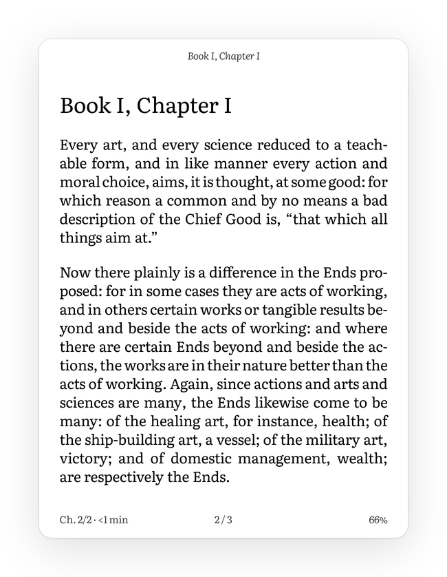

# UI framework: aristotle-ui

`crates/aristotle-ui` is the toolkit behind Aristotle's screens. It is a retained-mode UI in pure Rust, built for the PW4's e-ink panel. It draws into an 8-bit gray canvas, finds the smallest rectangles that changed and picks a waveform for each. It also turns raw touch events into gestures. The crate does not depend on `aristotle-hal`, so it builds and tests on any host, and a desktop preview renders the screens to PNG.

The reader app (`crates/aristotle`, see `docs/reader.md`) builds its library, settings, screensaver and reader menu from this crate. Some parts have run on the host only so far; see [Open issues](#open-issues).

## Model

```
touch events ──► input::GestureRecognizer ──► Ui::handle_touch ──► UiEvent (Action, Tap, Swipe…)
                                                   │                      │
                                                   ▼                      ▼
                                           press feedback (A2)     screen code mutates the Tree
                                                                          │
Tree (nodes, layout, paint, hit test) ◄───────────────────────────────────┘
   │
   ▼
Ui::render ── layout ─► candidate rects ─► repaint into Canvas ─► diff against front ─► Damage {rect, Waveform}
                                                                                              │
                              device: Canvas::blit_into(framebuffer) + Display::damage ◄──────┘
                              host:   PNG via aristotle-ui-preview
```

| Module | Contents |
| --- | --- |
| `canvas` | `Canvas` with 0 for black and 255 for white, and an explicit stride as in the framebuffer. Clipped `Painter`, pixel diffing, 16-level quantization. |
| `geom` | Integer `Rect`, `Size`, `Insets`. `mm()` and `pt()` at 300 DPI. `MIN_TARGET` is 9 mm, 106 px. |
| `waveform` | `Waveform::{A2, DU, GL16, GC16}` with the Zelda mode numbers (6, 1, 3, 2). |
| `text` | Fonts, shaping, rasterization, hyphenation, paragraph layout. |
| `tree` | The node tree: layout, painting, hit testing, and mutators that record damage. |
| `ui` | `Ui` holds the tree, the canvas and a copy of what the panel shows. It computes damage and dispatches gestures. |
| `icons`, `widgets`, `theme` | The icon set, custom leaves (cover card, battery, busy mark, toggle, slider, size steps) and the design tokens. |
| `screens` | `library`, `settings`, `sleep` and `reader`. |

### Tree and layout

Nodes live in an arena (`Vec<Node>` addressed by `NodeId`). The kinds are `Column`, `Row`, `Stack`, `Padding`, `Align`, `Fixed`, `MinSize`, `Text`, `Icon`, `Rule`, `Progress`, `Spacer`, `Pages` and `Custom(Box<dyn Widget>)`. Any node can carry a background, a rounded border, an action and a press `Feedback` (`Invert`, `Outline` or `None`).

Layout is one pass of box constraints, as in Flutter. The parent passes a minimum and a maximum size, the child picks its size, and the parent places it. Paragraph layouts are cached per width, so a text change reshapes only that paragraph.

`Pages` is the list container. It shows as many children as fit on one page and hides the rest, and `set_page` turns it. There is no scrolling container. On e-ink a scroll step is a panel update of 120 to 550 ms that leaves ghosting. A page turn is one update, and "Page 1 of 3" tells the reader where they are.

Change a tree through its mutators: `set_text`, `set_progress`, `set_hidden`, `set_page`, `set_inverted`, and `widget_mut` followed by `invalidate`. Each records the node and a `Refresh` class (`Auto`, `Transient`, `Page` or `Full`).

### Damage and waveforms

`Ui::render()` returns `Vec<Damage { rect, waveform }>`.

1. Each recorded change contributes its node's rectangle. Each painting node that moved, appeared or disappeared during layout contributes its old and new rectangles. Opening the reader menu therefore touches its two bars and leaves the page between them alone.
2. Each candidate is repainted into the canvas, clipped to its rectangle.
3. The result is compared with `front`, the copy of what the panel shows. Only the bounding box of the pixels that differ becomes damage (`Ui::minimal_damage()`). An identical repaint produces none.
4. Each rectangle gets a waveform from the reason it changed:

   | Cause | Waveform |
   | --- | --- |
   | Press feedback (`Refresh::Transient`) | A2 (6), about 120 to 144 ms |
   | New pixels all 0 or 255 | DU (1), about 309 ms |
   | New pixels with grays | GL16 (3), about 544 ms, no flash |
   | New screen (`set_tree`), night switch, each 6th page turn | GC16 (2), full screen, flashing |

5. The rectangles are coalesced. The stock driver runs one update at a time, and an update costs about one waveform whatever its size. So the default, `Coalesce::Single`, sends A2 feedback as one update and everything else as a second one with the most faithful waveform. GL16 leaves unchanged pixels alone, so the larger rectangle costs nothing visible. `Coalesce::Nearby` and `Coalesce::None` are for a driver that runs updates in parallel.

### The display thread

The driver blocks `MXCFB_SEND_UPDATE` while an earlier update is still on the panel, whatever the regions (`docs/eink-rendering.md`). The input loop must never submit. It draws and hands the damage to `aristotle_hal::display::Display`:

```rust
for d in ui.render() {
    ui.screen().blit_into(d.rect, fb_pixels, fb_stride);
    display.damage(hal_rect(d.rect), Waveform(d.waveform.mode()), &[]);
}
```

`Display::damage` never blocks. The `epdc-display` thread merges what arrives while the panel is busy into one rectangle with the most faithful waveform. It submits that and waits in the ioctl, so pixels drawn meanwhile go out together in the next update.

In the reader app, `Panel::present` (`crates/aristotle/src/panel.rs`) sits between `Ui` and the HAL, and `panel::plan` maps each hint to an EPDC request. GC16 becomes one full mode-8 update of the whole screen, the stock flash. A gray change of the book page behind the menu becomes one full mode-9 update, like a page turn. A2, DU and GL16 stay partial. Book pages bypass the display thread and go out directly as one full mode-9 update of the whole screen, as in the stock reader.

## Input

`GestureRecognizer` consumes `(phase, id, x, y, time_us)` events, a field-by-field copy of `aristotle_hal::input::TouchEvent`. In `GestureConfig` the tap slop is 4 mm and a long press 500 ms. A swipe needs 8 mm of travel along an axis that dominates the other by 1.5×. A second finger cancels the press.

The recognizer emits `Press` on touch-down, before it knows the gesture. `Ui` inverts or outlines the target at once with A2, so the highlight is on its way before the finger lifts. If the finger travels, `Cancel` withdraws it. Hit testing enlarges targets smaller than 9 mm to `MIN_TARGET`.

The reader page has its own recognizer (`crates/aristotle/src/turns.rs`). Taps turn on release. The top 12 % opens the menu, the left 30 % goes back and the rest goes forward. A hold selects a word and never turns.

## Transitions

Nothing may look broken. Each user action becomes one coherent update of its final state on the panel.

1. Build the whole frame, then submit once. A screen is laid out completely before `Ui::render`, with covers read and the battery and clock sampled. Two small partial updates come without a tap: the library rescan after the first frame, and the clock once a minute.
2. Acknowledge on touch-down, within 150 ms. Controls invert with A2, which takes 120 to 144 ms. DU would take about 309 ms. The result always replaces the inversion. Rows with cover photos get a heavy frame instead, so a photo never shows as a negative. If an action will take longer than about 300 ms, such as the first open of a MOBI book, the busy mark appears in the status line on release as one small DU update.
3. One refresh class per kind of change. A screen switch is one full mode-8 flash. An in-screen change is one partial update of the changed region, DU or GL16. List pages flash only when cards or cover photos were on screen, because their large grays ghost. An action never causes two flashes.
4. Overlays open and close in one step each. `screens::reader::mask_extents` places the edges of the menu's two bars in the white between lines of text. Opening sends one partial A2 update over both bars, which shows the menu in about 150 ms. Then `Panel::present_overlay` sends one full-mode gray update per bar on the `panel-sequence` thread. One update over the bounding box of both bars would redraw almost the whole page. Closing restores the page with one full mode-9 update.
5. The night switch is one flash into the inverted state.

`crates/aristotle-ui/tests/transitions.rs` checks rules 1, 2, 3 and 5 on the host from what `Ui::render` returns. The tests in `panel.rs` check how each hint becomes an EPDC request. On the device, `tools/scenarios/aristotle-ui.txt` walks the screens with `aristotle-observe`, which counts updates and flashes per interaction from the driver's log.

| Action | Updates | Panel time |
| --- | --- | --- |
| Chip, tab, toggle, settings choice, text-only list page | A2, then 1 partial DU or GL16 | 120–144 ms to the acknowledgement, then 309 or 544 ms |
| Screen switch, list page with covers | A2, then 1 full mode 8 | about 570 ms |
| Page turn, closing the menu, restyling | 1 full mode 9 | about 503 ms |
| Opening the reader menu | 1 partial A2, then 2 full-mode gray updates | about 150 ms to the menu, 1.2 s until settled |

The times come from `docs/pw4-reference.md` and `docs/native-vs-aristotle.md`. The scenario has yet to confirm them for the newer screens.

## Night mode

Night mode shows the library, the reader page, the menu and the settings as white on black. It is one switch, in the reader menu and in the settings, stored in `reader.json`. Screens are drawn in day colours and the final pixels are inverted. Anti-aliasing stays correct, and no screen needs a night variant.

<p>
  
  
</p>

Software inversion is the default. `Ui::set_night` inverts the UI canvas, and `Framebuffer::blit_inverted` inverts book pages during the copy to the framebuffer. Hardware inversion (`--night-method hardware`) sets `EPDC_FLAG_ENABLE_INVERSION` on each update through `Framebuffer::set_hw_invert`. The panel receives the same values either way. The software method keeps the framebuffer and the panel in agreement, so screenshots and the host preview are exact. With the hardware method, an update sent without the flag shows in day colours. Snapshots and the page cache always hold day pixels.

Night mode keeps the waveforms of page turns (full mode 9) and flashes (full mode 8). FBInk calls these the night waveforms (GLKW16, GCK16), and the stock UI uses them by day too. Only gray chrome changes. Partial GL16 becomes partial GLKW16 (mode 9), as in KOReader's `waveform_night`.

## Text

The text engine is swash. It does OpenType shaping (kerning, ligatures, marks, `smcp`, `onum`), hinting through skrifa and rasterization through zeno in one pure-Rust dependency. zeno also draws the icons. The alternatives lacked hinting (rustybuzz), GPOS kerning (fontdue) or room for our own line breaking (cosmic-text).

Hinting uses skrifa's smooth mode. It snaps the baseline and x-height to the pixel grid and keeps horizontal metrics linear, so justified lines keep exact widths. Coverage goes through `coverage^0.8` (`TextEngine::set_darkening`), because plain anti-aliased text looks thin on e-ink.

The fonts are in `crates/aristotle-ui/assets/fonts/` with their OFL texts. Literata is the UI and default reading face, compiled in by the `embedded-fonts` feature. Charis and Gentium Book are loaded from disk. They ship without bold, which is synthesized.

`text::layout_paragraph` breaks lines by UAX #14 and treats soft hyphens as hyphenation points. Justified text uses Knuth–Plass total fit, with a looser retry and first fit as fallbacks. Ragged UI text uses first fit, and headings can be balanced. A one-letter word or an initial never ends a line. `max_lines` truncates with an ellipsis.

Hyphenation goes through `trait Hyphenator`. `text::ui_hyphenator` returns `PolishSyllables`, a syllable rule without prefix knowledge, for Polish and nothing for other UI languages. Book pages are hyphenated by Plato with Liang patterns (`docs/reader.md`).

## Design system

The tokens live in `theme.rs`, and screens use nothing else. The look is a quiet page in Literata with one title per screen, 6 mm side margins, hairlines instead of boxes, and controls in solid black and white.

| Type token | Size | Use |
| --- | --- | --- |
| `DISPLAY` | 15 pt bold | The one title of a screen |
| `HEADLINE` | 12 pt bold | The book to continue, a shelf's name |
| `TITLE` | 11 pt bold | Screensaver caption |
| `ITEM` | 9.5 pt bold | The first line of a list row |
| `UI` | 8.5 pt | Tabs, chips, labels, buttons |
| `SMALL` | 7.5 pt, `INK_2` | Authors, values, the status line, the pager |

Spacing comes in multiples of 8 px (`Space::XS` 8 to `XXL` 64). Grays are panel levels, multiples of 17, and a test enforces it:

| Token | Day | Night | Use |
| --- | --- | --- | --- |
| `INK` | 0x00 | 0xff | Text, icons, controls |
| `INK_2` | 0x44 | 0xbb | Secondary text |
| `INK_3` | 0x66 | 0x99 | Captions, the lightest text allowed |
| `RULE` | 0xaa | 0x55 | Hairlines, inactive tracks |
| `TONE` | 0xdd | 0x22 | Quiet fills |
| `PAPER` | 0xff | 0x00 | Background |

Light grays wash out under the frontlight, so hierarchy comes from size, weight and space. Controls and progress fills are pure black and white and change with DU.

`icons::Icon::ALL` lists 38 outline icons on a 24-unit grid. `icons::stroke_px` picks a whole-pixel stroke per size. At the standard 48 px one unit is 2 px, so straight strokes cover whole pixels and stay pure black under A2 and DU. Icons sit in 9 mm buttons (`screens::icon_button`).

## Adding a screen

A screen is a builder in `crates/aristotle-ui/src/screens/` and a handler in the app. `screens/settings.rs` is the smallest complete example.

1. Write `build(...) -> (Tree, Ids)`. It takes plain data, such as `SystemView` for the settings, and returns the tree plus a struct of the node ids the app will change later. Use `status_line`, `icon_button`, `text_button` and `segmented` from `screens/mod.rs`, so targets stay at 9 mm.
2. Give the screen a `pub mod action` of `ActionId` constants. Ranges such as `LANGUAGE + i` cover lists of choices.
3. If the screen pages, add `sync` and `handle` to `Ids`. Page counts exist only after layout, so call `ui.layout()` and then `ids.sync(&mut ui.tree)` before rendering.
4. In `crates/aristotle/src/main.rs`, add a variant to `enum Screen`, a `show_*` method and an `on_*_event` handler, and route them in `on_ui_event` and `ui_driven`. `show_*` calls `ui.set_tree_with(tree, Refresh::Full)` for a screen switch and `Refresh::Auto` to rebuild the screen already shown, then `render_ui()`.
5. Add the screen to `src/bin/preview.rs` with sample data, and a case to `tests/transitions.rs`.

Inside a screen, change the tree with the mutators and call `render_ui()` once per action. A second render can become a second panel update, which breaks rule 3 of [Transitions](#transitions).

## Adding a widget

Implement `tree::Widget` for anything the node kinds cannot express:

```rust
pub trait Widget: Any {
    fn measure(&mut self, c: Constraints, text: &mut TextEngine) -> Size;
    fn paint(&self, rect: Rect, cx: &mut PaintCx);
}
```

Add it with `tree.custom(w)`. To change it later, call `tree.widget_mut::<T>(id)` and then `tree.invalidate(id, Refresh::Auto)`. Paint with theme grays only. A widget whose states are pure black and white, like `Toggle` or `BusyMark`, refreshes with DU. Interactive widgets need a 9 mm minimum through `MinSize` or `Tree::button`. `Slider` has no dragging, because a drag would need a stream of A2 updates. The app maps a tap's position with `Slider::value_at`.

## Languages

The UI is in English by default. The settings list the other embedded languages by their own names, and switching redraws the screen at once. User-visible strings live in `crates/aristotle-i18n/locales/<code>.json`, and `en.json` is the source of truth. The build generates enums from it, so a misspelt key does not compile:

```rust
use aristotle_i18n::{fmt_date, tf, tr, trn, Msg, Plural};
tr(Msg::LibraryContinueReading)                     // "Continue reading"
trn(Plural::LibraryBooks, n)                        // "1 book", "3 books"
tf!(Msg::CommonPageOf, page = 2, count = 5)         // "Page 2 of 5"
fmt_date(2026, 10, 17, 6)                           // "Saturday, 17 October 2026"
```

A locale file groups messages one level deep by screen (`"library": {"title": "Library"}`). Placeholders are written `{name}`, and plural messages are objects of forms (`{"one": "{n} book", "other": "{n} books"}`). The `"@locale"` object holds the formatting data. The build script checks each locale against `en.json` for keys, placeholders and plural forms, then embeds it, so a broken translation fails the build. Debug builds also check that `tf!` passes exactly the message's placeholders.

The language is process-wide (`set_language`). `with_language` overrides it on one thread for tests and previews.

`My Clippings.txt` entries keep the stock en_GB labels in all languages, because the firmware and import tools expect them. Book text, titles and authors are never translated.

### Adding a language

1. Copy `crates/aristotle-i18n/locales/en.json` to `<code>.json`, for example `de.json`.
2. Translate the messages and fill in `"@locale"`: `name` in the language itself, `decimal`, the twelve `months` as they appear in a date, the seven `weekdays` from Sunday, and the `date` (`{weekday}`, `{day}`, `{month}`, `{year}`) and `time` (`{h}`, `{hh}`, `{mm}`) patterns. Keep each `{placeholder}`.
3. If the language's plurals differ from "one for 1, other otherwise", add a rule to `crates/aristotle-i18n/src/plural.rs` (`Rule::for_language`, `categories`, `select`) with tests over 0, 1, 2, 5, 12, 14, 21, 22, 25, 112 and 122.
4. Run `cargo test -p aristotle-i18n`. The build names missing keys and wrong placeholders. A translation in progress can set `"complete": false` in `"@locale"`. Its missing messages then fall back to English with a build warning.
5. Check the screens with `aristotle-ui-preview --lang <code>` and the reader's `aristotle --preview ... --lang <code>`. Long words may need shorter wording in chips and segment labels.

The language then appears in the settings.

## Previews and tests

```sh
. tools/env.sh                                       # ARISTOTLE_CACHE and TMPDIR
export CARGO_TARGET_DIR=$ARISTOTLE_CACHE/target-ui
cargo run --release -p aristotle-ui --bin aristotle-ui-preview                      # $ARISTOTLE_CACHE/ui-preview/v2/
cargo run --release -p aristotle-ui --bin aristotle-ui-preview -- --lang all OUT_DIR  # OUT_DIR/en, OUT_DIR/pl, ...
cargo run --release -p aristotle-ui --example render-bench                          # timings, also on the device
cargo test -p aristotle-ui
```

The preview writes each screen as a 16-level PNG, by day and by night, with `*-damage.png` overlays of what each step would send. `targets.txt` lists the centre of each control for device scenarios. `ARISTOTLE_STOCK_HOME=capture.png` adds `compare-library.png`, the stock home screen beside ours. After changing a label, render all languages: a label that fits in English can wrap in Polish.

The crate has no C dependencies and cross-compiles with `--target armv7-unknown-linux-musleabihf`. `render-bench` is 2.66 MiB, of which embedded Literata is 1.22 MiB. `default-features = false` drops the embedded fonts and the PNG encoder. The reader app builds it that way and maps Literata from `data/serif/`.

## Traps

- Never submit from the input loop. Hand damage to `Display`, or the loop stalls for a whole waveform.
- Call `ui.layout()` before reading node rectangles or page counts, and sync pagers after it.
- Use `ui.next_deadline(now)` as the poll timeout and call `ui.tick(now)` after each poll. Otherwise a long press fires only with the next event.
- Change nodes through the tree's setters. Writing a node's public fields records no damage, so the change may never reach the panel.
- `set_tree` flashes. Rebuild the screen already shown with `set_tree_with(tree, Refresh::Auto)`.
- Use `Feedback::Outline` for large or photographic targets. Inverting them flashes a big block or a photo negative.
- Switch night mode through `App::set_night`, which sets both `Panel` and `Ui`. Setting only one leaves the UI and the book page in different colours.

## Open issues

- Night mode, the settings, folders and series, the two-step menu overlay, the busy mark and the screensaver have only run on the host. The device scenario must show whether A2 leaves residue the gray update does not clear, and how hardware inversion interacts with Lab126's ghost reduction.
- The screensaver turns the light off but does not suspend the CPU. `preventScreenSaver` is held so `powerd` does not draw over it. Real sleep needs `powerd` integration or our own suspend.
- There is no bidi support, and the script is fixed to Latin.
