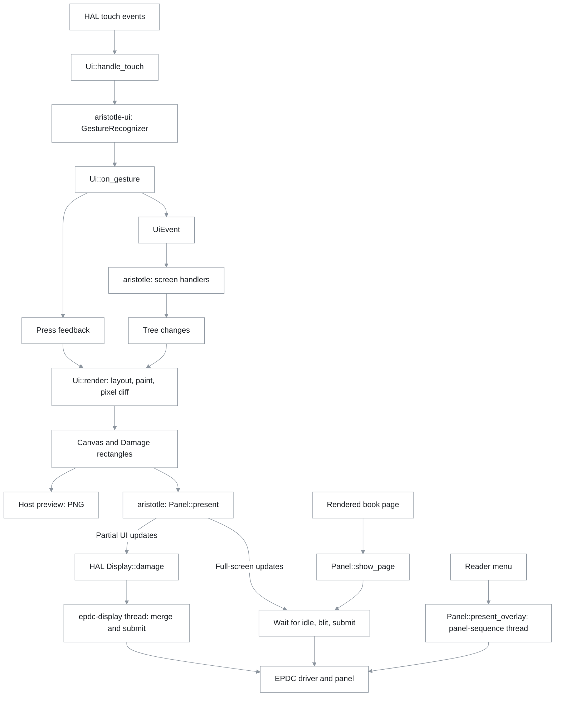

# UI framework: aristotle-ui

`crates/aristotle-ui` stores screens as a tree, draws them into an 8-bit gray canvas, and reports changed rectangles with waveform hints. A waveform controls how the e-ink panel updates. The crate also recognizes touch gestures.

It has no HAL dependency. The host preview draws the same screens as the app, without a device.

## Model



`Ui::render` produces pixels and hints, not hardware requests. `crates/aristotle/src/panel.rs` maps those hints to requests for the EPDC display controller. `crates/aristotle-hal/src/display.rs` owns the partial-update worker.

| Module | Contents |
| --- | --- |
| `canvas` | Gray pixels, clipping, pixel differences, and 16-level quantization |
| `geom` | `Rect`, `Size`, `Insets`, and units at 300 DPI |
| `waveform` | `A2`, `DU`, `GL16`, `GC16`, with Zelda mode numbers 6, 1, 3, 2 |
| `text` | Fonts, shaping, rasterization, and line breaks |
| `tree` | Nodes, layout, painting, hit tests, and changes |
| `ui` | Tree, canvas, previous pixels, damage, and gesture dispatch |
| `icons`, `widgets`, `theme` | Icons, controls, and style constants |
| `screens` | Library, settings, network, sleep, and reader menu |

### Tree and layout

A `NodeId` addresses a node in a `Vec<Node>`. Containers include `Column`, `Row`, `Stack`, `Padding`, `Align`, `Fixed`, and `MinSize`. Leaves include text, icons, rules, progress, spacers, and custom widgets.

Parents pass minimum and maximum sizes. Children choose their sizes, then parents place them. Paragraph layouts are cached by width.

`Pages` shows the children that fit on one page. `set_page` changes the visible page. There is no scrolling container.

Use tree setters such as `set_text`, `set_hidden`, and `set_progress`. They record damage with a `Refresh` class. After `widget_mut`, call `invalidate`. Direct field changes record no damage.

### Damage and waveforms

`Ui::render()` returns `Vec<Damage>`:

1. Collect rectangles for changed nodes and the old and new positions of moved nodes.
2. Repaint those rectangles into the canvas.
3. Compare the canvas with `front`, the previous pixels. Keep only the changed pixels' bounding boxes.
4. Choose a waveform hint for each rectangle.

An identical automatic repaint produces no damage. Explicit full refreshes bypass the pixel comparison. Press feedback uses A2. Black-and-white changes use DU, gray changes use GL16, and full refreshes use GC16 hints.

The app maps GC16 to a full-screen mode-8 flash. GL16 over book content, including completed gray popups, becomes a full-screen page refresh. Other partial hints go to `Display::damage`, which queues work without waiting for the panel. See [E-ink rendering](#e-ink-rendering).

## Input

`GestureRecognizer` accepts `(phase, id, x, y, time_us)`. Defaults in `GestureConfig` are 4 mm tap slop, a 500 ms hold, and an 8 mm swipe. A swipe axis must dominate the other by 1.5 times. A second finger cancels a press.

Touch-down starts A2 feedback. Movement cancels it. Hit tests expand small targets to `MIN_TARGET`, 9 mm or 106 px.

The book page uses `crates/aristotle/src/turns.rs`. Taps turn on release. The top 12 % opens the menu, the left 30 % goes back, and the remaining area goes forward. A hold selects text without turning.

## Transitions

The app draws a complete frame before it submits an update.

| Change | Update policy |
| --- | --- |
| Touch-down on a control | A2 inversion, or an outline around covers |
| Library or settings change | Partial DU or GL16 |
| Screen switch | One full mode-8 flash |
| List page | Flash when covers or cards require it |
| Page turn, menu close, restyle | One full mode-9 update |
| Reader menu open | Partial A2 over both bars, then a full-mode gray update per bar |
| Night-mode switch | One flash into the new state |

`mask_extents` places menu edges between text lines. `Panel::present_overlay` runs the updates on `panel-sequence`, leaving the page between the bars untouched by the gray updates.

`tests/transitions.rs` checks UI hints. Tests in `panel.rs` check hardware requests. `tools/scenarios/aristotle-ui.txt` exercises screens on the device. [Benchmarks](benchmarks.md) records measured interactions, including older menu behavior.

## Night mode

`App::set_night` updates both `Panel` and `Ui`. Software inversion is the default: `Ui::set_night` inverts UI pixels, and `Framebuffer::blit_inverted` inverts book pages. `--night-method hardware` uses `EPDC_FLAG_ENABLE_INVERSION` instead. Software inversion keeps screenshots consistent with the panel.

Snapshots and page caches store day pixels. EPUB images keep their day colors through `Page::images` and `panel::night_page`. MuPDF pages, including PDF, invert as a whole.

Turns stay full mode 9 and flashes full mode 8. Partial gray UI updates use GLKW16 instead of GL16 at night.

## Text

Swash shapes and rasterizes text. Hinting aligns text to the pixel grid. `TextEngine::set_darkening` applies `coverage^0.8` by default to make thin strokes darker.

Literata is the default font. The `embedded-fonts` feature compiles it into the UI. The app disables that feature and loads Literata from `data/serif/`.

`text::layout_paragraph` uses Unicode line-break rules. Justified text uses Knuth-Plass, which chooses breaks across a paragraph, with simpler fallbacks. Ragged text uses first fit. Soft hyphens mark possible breaks. A one-letter word or initial does not end a line. `max_lines` truncates with an ellipsis.

The UI's `Hyphenator` supports Polish syllable rules. Book pages use Plato's language patterns ([Hyphenation](reader.md#hyphenation)). There is no bidirectional text support, and shaping uses the Latin script.

## Design system

`theme.rs` defines type sizes, spacing, and grays. Screens use Literata, 6 mm side margins, and black-and-white controls.

| Type token | Size | Use |
| --- | --- | --- |
| `DISPLAY` | 15 pt bold | Screen title |
| `HEADLINE` | 12 pt bold | Continue-reading card, shelf name |
| `TITLE` | 11 pt bold | Screensaver caption |
| `ITEM` | 9.5 pt bold | List row title |
| `UI` | 8.5 pt | Controls and labels |
| `SMALL` | 7.5 pt | Secondary text and pager |

Spacing uses multiples of 8 px. Theme grays are multiples of 17, matching the panel's 16 levels.

| Token | Day | Night |
| --- | --- | --- |
| `INK` | `0x00` | `0xff` |
| `INK_2` | `0x44` | `0xbb` |
| `INK_3` | `0x66` | `0x99` |
| `RULE` | `0xaa` | `0x55` |
| `TONE` | `0xdd` | `0x22` |
| `PAPER` | `0xff` | `0x00` |

## Adding a screen

1. Add a builder in `src/screens/` that returns `(Tree, Ids)`. Use the shared controls in `screens/mod.rs`.
2. Define `ActionId` constants in a `pub mod action`.
3. For paged screens, add `Ids::sync` and `Ids::handle`. Call `ui.layout()` before syncing page counts.
4. Add a `Screen` variant and event handlers in `crates/aristotle/src/main.rs`.
5. Use `Refresh::Full` for a screen switch and `Refresh::Auto` to rebuild the current screen. Render once per action.
6. Add preview data in `src/bin/preview.rs` and a transition test.

## Adding a widget

Implement `tree::Widget`:

```rust
pub trait Widget: Any {
	fn measure(&mut self, c: Constraints, text: &mut TextEngine) -> Size;
	fn paint(&self, rect: Rect, cx: &mut PaintCx);
}
```

Add it with `tree.custom(w)`. Change it through `tree.widget_mut::<T>(id)`, then call `tree.invalidate(id, Refresh::Auto)`. Use theme grays and a 9 mm minimum touch target. `Slider` responds to taps through `value_at`, not drags.

## Languages

English is the default. `crates/aristotle-i18n/locales/en.json` defines the message keys. The build checks each locale's keys, placeholders, and plural forms. Debug builds also check arguments to `tf!`.

`set_language` changes the process-wide language. `with_language` overrides it on one thread for tests. Book text and metadata are not translated. `My Clippings.txt` keeps en_GB labels in every language.

### Adding a language

1. Copy `crates/aristotle-i18n/locales/en.json` to `<code>.json`.
2. Translate messages without changing `{placeholder}` names. Fill in `@locale`, including names, months, weekdays, and date and time patterns.
3. If needed, add plural rules and tests in `crates/aristotle-i18n/src/plural.rs`.
4. Run `cargo test -p aristotle-i18n`. An incomplete catalog can set `"complete": false` and fall back to English.
5. Check all screens with `aristotle-ui-preview --lang <code>` and the app's `--preview` mode.

## Previews and tests

```sh
. tools/env.sh
export CARGO_TARGET_DIR="$ARISTOTLE_CACHE/target-ui"
cargo run --release -p aristotle-ui --bin aristotle-ui-preview
cargo run --release -p aristotle-ui --bin aristotle-ui-preview -- --lang all OUT_DIR
cargo run --release -p aristotle-ui --example render-bench
cargo test -p aristotle-ui
```

Previews include day and night PNGs, `*-damage.png` overlays, and `targets.txt` with control coordinates. `ARISTOTLE_STOCK_HOME=capture.png` adds a stock-library comparison. Check all languages after label changes.

## E-ink rendering

The EPDC, the display controller, reads pixels from the framebuffer only when asked to update. `MXCFB_SEND_UPDATE` submits a rectangle and waveform. `MXCFB_WAIT_FOR_UPDATE_COMPLETE` waits for a marker to finish.

### Waveforms

The PW4 uses Zelda mode numbers from FBInk's `mxcfb-kindle.h`, not PW2 numbers. The [device reference](pw4-reference.md#waveform-modes-and-timings) lists every measured mode. These timings come from `aristotle-observe bench latency` on our device [dev]:

| Waveform | Mode | Time for a 120 × 120 region |
| --- | --- | --- |
| A2 | 6 | 120 to 144 ms |
| DU | 1 | 309 ms |
| GL16 | 3 | 544 ms |
| GC16 | 2 | 544 ms |

A2 is fast but leaves residue. DU handles black and white. Gray updates take longer. Real reading uses full mode 9 to avoid ghosting ([Page-turn experiment](benchmarks.md#page-turn-strategy-experiment)).

### Display thread

Measurements on our PW4 show that the driver processes one update at a time [dev]. A submit blocks behind an earlier update even when regions do not overlap. Deeper queues and smaller tiles did not help.

`Display::damage` merges pending rectangles and keeps the most faithful requested waveform. Only `epdc-display` waits in the submit call. Pixels drawn while the panel is busy go out in the next update.

`Completions` waits for markers on another thread. Only one thread can wait for a given marker because the driver forgets it after completion.

### Code map

| Code | Role |
| --- | --- |
| `crates/aristotle-hal/src/framebuffer.rs` | Framebuffer and update calls |
| `crates/aristotle-hal/src/display.rs` | Display worker and completion tracking |
| `crates/aristotle-hal/src/input.rs` | Touch input and timestamps |
| `crates/aristotle/src/panel.rs` | App update policy and page path |
| `crates/aristotle-observe/src/bench/` | Panel benchmarks |

## Traps

- Queue partial UI updates through `Display`, not the input loop.
- Wait for previous page updates before replacing the page's framebuffer pixels.
- Call `ui.layout()` before reading rectangles or page counts.
- Use `ui.next_deadline(now)` for the poll timeout and call `ui.tick(now)` after each poll, so holds fire without another touch event.
- Change nodes through setters. After changing a custom widget, invalidate it.
- `set_tree` flashes. Use `set_tree_with(tree, Refresh::Auto)` to rebuild the current screen.
- Use `Feedback::Outline` for covers and other large targets.
- Change night mode through `App::set_night`.
